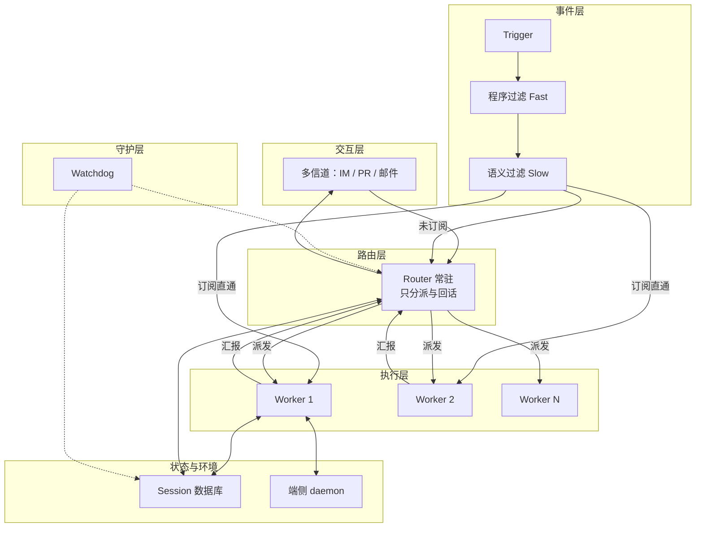
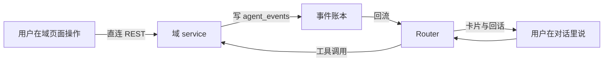

# 架构总览：Super-agent 原理与应用映射 v1

> 版本：v1 · 状态：总览稿（细节以增量架构为准）
> 用途：一条线讲完「原理 → 我的应用对应哪块 → 三种交互怎么设计」。
> 前置阅读：
> `docs/研究-SuperAgent设计框架与落地改造-v1.md`（原理研究）
> `docs/架构设计-增量-Agent底座-v1.md`（目标架构与 8 表设计）
> 标注约定：原文事实直陈；工程判断标【判断】；原文外补充标【补充·非原文】。

---

## 第一部分：Super-agent 的架构与原理

### 1.1 它要解决的问题

结论：单 ReAct Loop 有四个硬伤，而真正的瓶颈是人的注意力。

四个硬伤：

- 阻塞：一次同步工具调用期间，会话收不到新输入。
- 串行：一个循环只能跑一件事，多任务只能排队。
- 离线即停：计算和会话绑在本机，合盖就断。
- 上下文混乱：多任务的中间细节挤在同一窗口里。

第四个硬伤带来直接后果：

- 一个人通常只能同时跟进 3 到 5 个活跃 Session。
- 超过这个数，人开始记错上下文。

原文的判断是：

- 单任务上限取决于模型能力。
- 多任务上限取决于人的注意力。

因此方向不是"让模型更强"，而是"把会话管理交给系统"。

### 1.2 四个基础特征

连续：

- 定义：用户面对的是同一个 Agent，不用记哪句话在哪个会话。
- 反例：IM 里定了方案 A，PR 里改成 B，它还在按 A 执行。

高效：

- 定义：不阻塞，能并行推进多个复杂任务。
- 反例：后台跑着命令，用户发第二条消息毫无反应。

主动：

- 定义：持续观察环境事件，判断值得做就自己做。
- 反例：没人 @ 就一动不动。

持久：

- 定义：始终在线，异常能自恢复。
- 反例：设备休眠即停，重启后忘了刚才在干什么。

原文结论：一个 ReAct Loop 撑不起这四个特征。

### 1.3 五个模块总览

结论：五个模块各补一个洞，缺一个就退化成聊天窗口。

- 双层架构：补「连续与高效不可兼得」——上下层分工。
- 事件驱动：补「被动等指令」——环境事件成为驱动源。
- 面向人的交互：补「阻塞与表达失配」——异步加按信道输出。
- 计算/状态/环境分离：补「离线即停」——三步变两层解耦。
- Watchdog：补「长期运行必烂」——外部控制回路。



### 1.4 逐模块原理

#### 双层架构

要点一：Router 的三条约束都有理由。

- 不执行具体任务：全局节点一旦干活就成瓶颈。
- 用轻量模型：它是长输入短输出，判断不需要最强模型。
- 靠批处理：推理期间到达的事件积压合并，摊薄单次成本。

要点二：Worker 的三条约束同样有理由。

- 上下文隔离：多任务细节不互相污染。
- 用最强模型：它直接决定交付质量。
- 不直接对人：多个会话各自回话就是灾难。

要点三：它和常见 Agent Team 不是一回事。

- Team 是单个复杂任务内拆步骤。
- Team Lead 要理解细节、高频协调，推理负载很重。
- Super-agent 只处理任务之间的关联与分派。
- Router 不介入单任务内部拆解。

要点四：切分是连续的权衡。

- 切得越细，Router 吞吐越高。
- 切得越细，全局记忆连续性越低。
- 全局记忆问题没解决前，这个权衡一直在。

要点五：为什么双层能同时满足两个特征。

- 把「维护全局连续性」与「高并发执行」拆到两层。
- 常驻层管连续性，隔离层管吞吐；用户只感到一个 Agent。

#### 事件驱动

要点一：为什么必须换驱动源。

- 人逐条打字，天然被动。
- 环境持续产事件，才有主动的可能。

要点二：两级过滤是成本约束的必然结果。

- 每条都调模型，延迟和算力都不可接受。
- 程序层做确定性准入，滤掉大部分噪音。
- 语义层只判候选，同时也是自然语言策略扩展点。
- 三档处置：仅响应明确请求 / 作为候选 / 直接忽略。

要点三：Thread 与订阅直通解决 Router 过载。

- 同一 PR、同一 IM 话题的连续事件构成 Thread。
- 已订阅的直接发 Worker，不经 Router。
- 未订阅的才交 Router 判断。
- 订阅是多对多：一个 Worker 订多 Thread，一个 Thread 多 Worker 订。
- 广播让 Worker 自行发现冲突，省掉点对点通信。

要点四：Inline & Spill 把上下文窗口当 Cache。

- 注入太多：挤占窗口、稀释注意力。
- 注入太少：反复调工具读取，步数暴涨。
- 做法：常用信息内联，低频信息留窗外只留引用。
- 局部性指导顺序：先紧密关联，再时空相邻。
- 超限即截断，保留续读入口。

要点五：链式召回缓解长程遗忘。

- Trigger、Thread、Session 都有唯一 ID。
- 注入时内联下一跳的 ID 与摘要。
- 底层形成引用图，可逐跳展开。

要点六：投机执行换的是人的等待。

- 环境信号一出现就在后台试。
- 有价值就交付，没价值就丢弃。
- 例：群里有反馈，先静默复现修复，确认了才说话。

#### 面向人的交互

要点一：半双工是真问题。

- 经典 run() 是同步的，循环会阻塞。
- 阻塞期间收不到任何用户输入。
- 结果就是：跑一次长命令，助手"失联"几分钟。

要点二：异步 start()/stop() 的改造很小，效果很大。

- start() 立即返回 Started，循环不等待。
- 完成结果作为一条新事件投回会话。
- 模型可调 stop() 终止跑太久的命令。
- 前台响应与后台执行彻底解耦。

要点三：多信道不是"多接几个口"，是输出密度要匹配。

- 群聊里输出完整推理过程，等于制造信息过载。
- IM 只问直接问题、只给短结论。
- 验证过的硬规定：单次回复不超 100 词。
- 【判断】硬数字比"要简洁"这种软要求有效得多。
- GitHub 与邮件反过来：要完整背景、改动说明、验证结果。

#### 计算、状态与环境分离

要点一：两步解耦，不能一步到位。

- 第一层：计算与状态分开——计算无状态，状态入库。
- 第二层：计算与执行环境分开——环境留在原地。
- 只做第一层拿不到本机环境，只做第二层重启就丢会话。

要点二：为什么环境不能复制。

- 有未提交的本地修改。
- 有私有凭据。
- 依赖内网服务。
- 依赖特定硬件或工具链。
- 【判断】这四条任一条成立，云端重建就必然出错。

要点三：daemon 的定位很窄。

- 只执行命令、只返回结果。
- 不保存任何会话状态。
- 这就是 BYOM：把自己的机器接入云端 Agent。
- 还支持间歇在线设备：上线后补跑该设备上的任务。

#### Watchdog

要点一：为什么必须放在主系统之外。

- 主系统自己判断自己，出错时判断能力一起坏。
- 需要一条独立的控制回路。

要点二：三类失败，只有一类能靠脚本抓。

- 崩溃：进程没了，脚本能抓。
- 空转：有活动但没产出，脚本抓不到。
- 偏航：在做但做错方向，脚本更抓不到。

要点三：所以它必须是 Agent 而不是脚本。

- 判「有没有实质进展」需要读上下文与产出。
- 判「是否偏航」需要理解目标。
- 它本身有完整工具，能在线修正主系统行为。
- 维护者还能用自然语言问它"昨晚为什么失败"。

要点四：处置节奏也有讲究。

- 发现异常立即介入修复；偶发故障持续复查直至恢复。
- 两者不是同一动作，别混。

### 1.5 两个关键数据

消融实验（四种方案，5 次重复）：

- Super-agent：p50 12.4 分，p95 15.7 分。
- 单 Session + Subagent（中性提示）：20.4 / 29.5 分。
- 单 Session + Subagent（优先委派）：13.8 / 29.0 分。
- 读缓存 token：Super-agent 2323 万。
- 去掉订阅直通后：3177 万，且 Router 决定数增加约 30%。
- 结论一：双层架构比提示词约束更稳。
- 结论二：直通不提速，但真省 token。

批处理压测：

- Trigger 从每分钟 1 条升到 40 条。
- 平均批量从 1.0 升到 2.8。
- 单次请求从 2.5 秒增到 3.9 秒。
- 单个决定分摊时间从 6.4 秒降到 1.6 秒。
- 结论：拥堵反而摊薄单决定成本。

限定语（原文自述，必须保留）：

- 实验基于合成负载与简化环境。
- 编码工具只耗时，结果仅作初步参考。

### 1.6 四个开放问题

8.1 怎么扩展双层架构：至今无解。

- 切分时机、粒度、Worker 间是否直连，均无定论。
- 长程记忆是跨月运行的主要瓶颈。

8.2 脱离 Session 之后怎么协作：至今无解。

- 不以会话为界面单位后，任务怎么呈现给用户没有标准答案。
- 中途介入、接管、实时协同的形态仍在探索。

8.3 上下文边界与 A2A：至今无解。

- 组织越大，越是在划分「谁共享上下文、谁隔离」。
- 跨实例协作的权限与安全边界没有成熟方案。

8.4 安全与隐私：至今无解。

- 事件驱动扩大了不可信输入的接触面。
- 云端被攻破会波及全部接入的端侧设备。
- 凭据进上下文即有泄露风险，需「不接触也能用」的机制。

---

## 第二部分：映射到本应用

### 2.1 现状速写

技术栈：

- 后端 FastAPI + PostgreSQL，前端 `prototype/v2` 单页原型。
- 部署 docker-compose + Caddy，纯 IP 直连自签 HTTPS。
- 流水线 Hatchet，与 api 同镜像不同进程，复用现有 PG 独立库。

Hatchet 现有 3 条 task：

- `papers-daily-crawl`：cron，每天 7:30 抓取。
- `papers-daily-cleanup`：cron，每天 8:30 清理 7 天滚动。
- `papers-parse`：事件触发，解析全文；引擎未接线时回落进程内。

现有表 8 组共 28 张：

- 账号 RBAC 5、模型网关 6、应用注册 3、对话 2。
- 用户设置 1、记账 2、文献 7、其他（key、技能）2。

其他现状：

- 测试 291 用例全绿，ruff 干净。
- 模型网关已有指派、备用链、熔断、计费统计。
- 论文域已有订阅抓取、解析、批注、翻译、全文解耦。

### 2.2 逐模块对账

结论：23 项里已有 3、部分 9、缺 9、不需要 2。

| 框架机制 | 现在的对应物 | 结论 |
| --- | --- | --- |
| Router（全局路由与统一出口） | 无。前端自己按 app_id 调 `/chat` | 缺 |
| Worker（隔离执行会话） | `papers-parse` 有执行、有状态，无汇报 | 部分 |
| 订阅直通（Thread 直达） | 无。只有 `push_parse_event` 单点推送 | 缺 |
| Router 批处理 | 无。事件按天算，量级不需要 | 不需要 |
| 定时 Trigger | Hatchet 两条 cron：抓取 + 清理 | 已有 |
| 任务级事件 | 只有 parse 一种，无通用事件表 | 部分 |
| 用户消息事件 | `/chat` 一次请求一条，不落事件表 | 部分 |
| 两级过滤 | 有关键词命中与打分，但筛的是论文不是事件 | 部分 |
| 事件账本（可回放） | 无。`papers_crawl_runs` 只记抓取轮次 | 缺 |
| Inline & Spill | `build_messages` 取最近 N 轮，超出直接丢 | 部分 |
| 链式召回 | 批注互链 + backlinks 反查，仅论文域 | 部分 |
| 投机执行（提前行动） | 无。解析必须用户点按钮 | 缺 |
| 全双工（异步工具） | SSE 单向；长任务靠前端轮询状态列 | 部分 |
| 统一出口（单一回话人） | 前端按状态列自己拼结果 | 部分 |
| 多信道交互 | 只有 Web 一种信道 | 缺 |
| 计算与状态分离 | FastAPI 无状态 + PG 存全部状态 | 已有 |
| 执行环境分离（daemon / BYOM） | 单机自部署，Agent 与环境同机 | 不需要 |
| Watchdog 探活 | docker healthcheck + `/api/status` 状态灯 | 已有 |
| Watchdog 任务进展判断 | 无。卡死靠人看状态列 | 缺 |
| 三层会话（Session / Task / Turn） | 只有 `chat_conversations` + `chat_messages` 两层 | 缺 |
| 工具注册表与契约 | 无。工具就是各域 REST 接口 | 缺 |
| delegation（代用户操作授权） | 无。JWT 只说明"是本人" | 缺 |
| 可观测全景（trace 贯穿） | `llm_call_logs` 有记账，无任务级贯穿 | 部分 |

口径说明：

- 原清单枚举 24 项，本表把「计算无状态」「状态持久化」并为一行。
- 两者同为「已有」，合并后对齐 23 项与 3/9/9/2；单项结论未改。

### 2.3 缺口依赖顺序

结论：顺序不能反，反了就会返工。

六步顺序：

1. Task 层（三层会话表）。
2. 事件账本。
3. Router。
4. 工具注册表。
5. 守护。
6. 多信道与 daemon。

为什么不能反：

- 没有 Task 层，事件没有宿主，任务状态无处可挂。
- 没有事件账本，Router 没有输入，只能靠同步请求触发。
- 没有 Router，工具没人调度，注册表只是清单。
- 没有工具注册表，Router 调度没有契约，越权无从拦截。
- 没有守护，长跑任务会积压成谜，越晚补越难排查。
- 多信道与 daemon 是放大器：前面不稳就放大会放大故障。

【判断】第 6 步应当长期不做。
理由见 2.4 与三处拍板：页内 digest、单机自部署。

### 2.4 逐模块实现方案

#### 2.4.1 双层架构

Router 落点：

- 代码 `services/agent/router.py` 与 `router_loop.py`。
- 进程在新增的 `agent-worker` 容器里。
- 模型走 `app_key=agent_router` 的指派行。

Router 每轮五步（无状态）：

1. 取 Session：按事件里的 `session_id` 从库读会话与最近 K 轮。
2. 组装上下文：会话摘要 + 最近轮 + 活跃任务清单 + 域片段。
3. 模型决策：一次调用，输出结构化 JSON。
4. 派发：要干活就建 Task 并推事件。
5. 写回：写 Turn 段、写激活记录、写账。

【判断】关键是"每次都重建"。
进程里不缓存任何会话状态，重启即等价于热启动。

Worker 落点：

- 直接复用现有 Hatchet 机制，不新造执行器。
- 新增 workflow `agent-task-run`，事件触发，一次一个 Task。
- 执行体就是现有 service 函数，加心跳与预算检查。

订阅直通怎么表达（本项目版本）：

- 不新增订阅表。
- 用聚合 ID 在事件表上表达归属：`paper_id`、`run_id`、`task_id`。
- Router 只在「首次出现该聚合 ID」时介入。
- 后续同 ID 事件由消费者直取，不再过 Router。

【判断】这里的取舍是：不上完整订阅模型。
两人规模、事件量小，聚合 ID 足够，且少一张表少一处不一致。

与既有约定如何衔接：

- 模型指派沿用 `model_assignments`，新增两行即可。
- 熔断沿用 `model_circuit_states`，无需改动。
- 记账沿用 `llm_call_logs`，只加一列 `trace_id`。

#### 2.4.2 事件

表 `agent_events`（完整字段见增量架构 §4.5）核心列：

- `event_type`、`aggregate_type`、`aggregate_id`。
- `user_id`、`session_id`、`task_id`。
- `payload`、`source`、`idem_key`、`replayable`。
- `consumed_at`、`attempts`、`trace_id`。

event_type 分组：

- 用户面：`user.message`、`user.instruction`、`user.interrupt`。
- 确认面：`user.approve`、`user.reject`。
- 任务面：`task.created`、`started`、`progress`、`finished`、`failed`、`cancelled`、`retry`。
- 工具面：`tool.called`、`tool.failed`、`tool.denied`。
- 领域面：`money.transaction_added`、`papers.*` 四类完成事件。
- 守护面：`watchdog.*`、`circuit.*`、`budget.exceeded`。

幂等键规则：

```
{event_type}:{aggregate_type}:{aggregate_id}:{version}
```

- `version` 取状态哈希或秒级时间戳。
- 唯一索引兜底，重复写入直接丢弃。
- 写事件与业务变更同事务，即 outbox 语义。

补发：

- 新增 cron `agent-event-replay`，每 2 分钟。
- 取 `consumed_at is null` 且超过 5 分钟的事件重投。
- `attempts ≥ 3` 转 `watchdog.escalated`，不再自动重试。

回放：

- 按 id 升序重放，仅限 `replayable=true`。
- 写类工具调用一律标 `replayable=false`。
- 回放只用于重建视图，不重放副作用。

#### 2.4.3 交互

SSE 改造三段式：

1. 立即 ack：收到请求先回 `{turn_id, status:"accepted"}`。
2. 任务卡：决定要干活就先推一张任务卡（含 task_id）。
3. 结果回投：任务完成后推结果段，流可关可续。

统一出口：

- 任务状态由 Router 汇总后回话。
- 前端不再猜状态列的含义。
- 域状态列仍存在，但只作为 Router 的输入。

多信道：

- 只留 `Channel` 接口，一个实现（Web）。
- 接口方法就两个：`deliver(turn_segment)`、`notify(event)`。
- 【判断】不实现 IM 或邮件。
  与 P1「页内 digest、不做外部推送」拍板一致，接口留着即可。

#### 2.4.4 计算与状态分离

现状已达标，只需固化规范。

- 规范一：禁止进程内缓存会话状态。
- 规范二：重启后必须能从库恢复全部上下文。
- 规范三：摘要一律进 `agent_memory`，不进进程内存。

【判断】这三条写成测试断言比写成文档更有效。
建议各配一条集成测试。

#### 2.4.5 守护

七项扫描（每 5 分钟）：

1. 卡住任务：心跳超阈值。
2. 空转任务：有调用无产出。
3. 事件积压：未消费超阈值。
4. Router 失活：有事件但无激活。
5. 熔断滞留：`open` 超 30 分钟未探测。
6. 预算越界：`used_tokens` 超上限仍在跑。
7. 孤儿任务：会话已删但任务未终结。

卡住与空转的判据必须分开：

- 卡住 = 心跳停了，含义是进程或外部服务死了。
- 空转 = 有活动没产出，含义是模型原地打转。

动作分级：

- L1 自动：重投事件、重试未超限任务、关闭超时熔断。
- L2 半自动：标失败写原因 + 给恢复建议，等用户一句话。
- L3 人工：只报不动，写 `watchdog.escalated` 并亮红。

留痕：

- 每轮扫描写 `watchdog.*` 事件，`payload` 记命中项与判据。
- 管理页按时间倒序看，可按级别筛。

误判防护五条：

1. 心跳窗口 ≥3 倍典型步耗时。
2. 重试前查工具调用时间戳，确认真无活动。
3. 同任务 24 小时最多自动重试 2 次。
4. 空转需连续两次扫描命中。
5. 只对幂等工具自动重试。

#### 2.4.6 架构级三件

三层会话表结构：

- 会话 `agent_sessions`：一条对话线，不带 `app_id`。
- 轮次 `agent_turns`：一问一答，含 `segments` 与计费列。
- 任务 `agent_tasks`：一个工作单元，含预算、心跳、`result`。
- 完整字段见增量架构 §4.2-4.9，本文不重复铺开。

工具契约十项：

- `name`、`domain`、`description`、`params_schema`、`permission`。
- `side_effect`、`exec_form`、`exec_target`、`idempotency`、`timeout_s`。
- handler 永不入库，只能代码注册，DB 只做开关与文案覆盖。

delegation 结构：

```
{user_id, domains: [...], max_side_effect, expires_at, confirmed: []}
```

- 建 Task 时快照，默认拒绝，逐项放行。
- 破坏性动作必须在 `confirmed` 内才可执行。

trace_id 与三表拼全景：

- 每 Task 一个 `trace_id`。
- 贯穿 `agent_events`、`agent_tool_calls`、`llm_call_logs`。
- 一次任务的全景 = 事件时间线 + 工具明细 + 成本明细。

### 2.5 影响面

表：

- 新增 8 张 `agent_*` 表。
- 现有表增 1 列：`llm_call_logs.trace_id`。
- `chat_conversations` / `chat_messages` 转只读。
- 表总数 28 → 36。

容器：

- 新增 `agent-worker`，复用后端镜像换启动命令。
- compose 服务数 5 → 6，建议 `mem_limit: 512m`。
- 不新增端口，不新增 Web 入口。

用户可见：

- 主入口改名「个人 Agent 助手」。
- 对话可跨域，出现任务概念（可见、可取消、可重试）。
- 异步完成有主动汇报。
- 三个域页面保留，定位从「应用」变「能力域」。

文档同步：

- `架构定稿-v1.md`：主形态与提示词口径。
- `PRD-v1.md`：新增 Agent 助手需求段。
- `架构设计-v1.md`：接口与表结构对齐。
- `项目地图-v1.md`：新增 `services/agent/`。
- `依赖锁定清单-v1.md`：注明零新增依赖。

测试影响：

- 现有 chat 相关用例约 20-30 个需改写。
- 新增四类：状态机、幂等、预算、守护判据。

---

## 第三部分：三种交互

### 3.1 用户 ↔ 个人 Agent

#### 唯一入口

- 主入口 `#/agent`，命名「个人 Agent 助手」。
- 三个域页面保留：记账台账、论文库、对话设置。
- 定位变成「能力域」，不再是并列的应用。

【判断】保留域页面是必须的。
台账和阅读器塞进聊天流会难用。
原文 8.2 也主张交互落在领域特化界面。

#### 三种形态分工

- 对话式：开放式提问、跨域编排、解释追问。主导方是 Agent。
- 卡片加跳转：给结构化结果，需要细看再操作。主导方是 Agent 给卡，用户点进页面。
- 面板式：高频固定操作，如记一笔、读论文批注。主导方是用户，Agent 只在旁辅助。

判断标准（一句话）：

- 一句话说不清要什么 → 对话式。
- 需要看细节再决定 → 卡片加跳转。
- 每天都要重复做 → 面板式。

#### 一轮对话五步

1. 输入：用户提交文本，前端先写一条 Turn（`pending`）。
2. 从库重建：后端读会话、最近 K 轮、活跃任务、摘要。
3. 模型决策：一次调用，产出「回话 / 建任务 / 静默」。
4. 工具执行：需要就 inline 直调，或 async 建 Task。
5. 卡片回话：推结果段与卡片，写库，Turn 置 `done`。

分支：直接回答跳过第 4 步。

- 纯知识问答、纯解释，不碰业务数据。
- 这一支要保证足够快，别为"架构完整"绕一圈。

#### 状态呈现三规则

规则一：长任务在对话里必须可见。

- 先出任务卡：干什么、第几步、能不能取消。
- 用户不必去别的页面找。

规则二：任务不随对话消失。

- 翻到别的会话，任务中心里还能找到。
- 【判断】这是"连续"这条特征在产品侧的最低要求。

规则三：失败说人话，并给下一步。

- 不说「上游 502」，说「这篇没拿到全文，可以手动上传」。
- 后面必须跟一个可点的动作。

#### 能力可见性

- 有「能力清单」页：每个工具一句人话 + 一个可点示例。
- 空态给 3-5 个示例，不让用户面对空白输入框。
- 例：「昨天花了多少」「把这周的 AD 论文加收藏」。

### 3.2 应用 ↔ Agent

结论：只有四条契约，一条不能多。

#### 契约一：工具调用

- 入参由服务端注入 `user_id`，不信前端传值。
- 必带 `delegation`，无授权即拒绝。
- 必带超时阈值，默认 30 秒，长任务 900 秒。
- 判定 inline 还是 async 看一件事：会不会超过 5 秒或要等外部服务。

#### 契约二：结果卡片

- JSON 结构：`{type, title, fields[], actions[], link}`。
- `type` 走白名单。
- 无渲染器或未知 `type` → 退化为纯文本。
- 【判断】退化机制是硬要求。
  否则每加一个工具都要改前端。

#### 契约三：事件上报

- 应用写 `agent_events`，异步，不阻塞业务事务。
- 这是「主动」的唯一合法来源。
- 写完就结束，不关心谁消费。

#### 契约四：跳转带上下文

- 形如 `#/papers/123?from=chat&task=45`。
- 只传标识，不传内容。
- 域页面读 `from` 决定回填或回话。

#### 禁令

- 应用不得反向调用 Agent。
- 只能写事件，由 Router 自己决定何时看。
- 【判断】反向调用会让"谁决定何时说话"失控，且难审计。

### 3.3 应用 ↔ 应用

#### 铁律

- 应用之间禁止直接调用。
- 读：经 Agent 编排，由 Router 依次调工具。
- 写：写完发事件，别人想反应就订阅。
- 不允许 A 域 service 里 `import` B 域 service 做跨域动作。

#### 跨域编排两例

例一：论文 → 记账。

- 用户说「把这篇的实验成本记到账本备注」。
- Router 先调 `papers.get_detail` 取标题。
- 再调 `money.add_transaction`，备注填标题。
- 两域三步，一条任务链，一次回话。

例二：论文域内部批量。

- 用户说「这周新增里跟 AD 相关的都加收藏」。
- 先 `papers.search_digest`，再按关键词过滤。
- 然后 `papers.add_to_library` 逐条执行。
- 超过 10 条先列清单确认，不闷头刷。

#### 数据隔离

- 所有表行级 `user_id`，查询一律带过滤。
- 域前缀隔离存储与命名，如 COS 的 `papers/`。
- Agent 不得跨用户取数，两人各自独立。

#### 跨域操作上限

- 单次 ≤3 个域。
- 单次 ≤10 条记录变更。
- 超限先出清单，用户确认后执行。
- 阈值写进工具契约，不靠模型自觉。

### 3.4 两条路径与事件回流

结论：页面直连 REST，对话经 Router，两条路共用同一 service。



四条要点：

- 路径一：页面直连 REST，快，不经过 Agent，人是主导。
- 路径二：对话经 Router，Agent 主导，能串多域。
- 共用实现：两条路都调同一个 service 函数，不允许两份逻辑。
- 事件回流：service 写完发事件，Router 消费后形成主动。

【判断】第三条最容易破：为 Agent 另写一套 service，行为必然分叉。

---

## 收尾

### 与既有文档的关系

- 本文是总览，讲清一条链路。
- 原理细节以 `研究-SuperAgent设计框架与落地改造-v1.md` 为准。
- 目标架构、字段、DDL 以 `架构设计-增量-Agent底座-v1.md` 为准。
- 与增量架构的两处口径差异，明确如下：
  - 本文 2.2 对账为 23 项，增量架构未列对账表，无冲突。
  - 本文 3.2 的四条契约是新增内容，增量架构只在 §10 提了 delegation，未列交互契约。

### 仍需用户拍板（7 项，沿用上一份）

1. 容器形态：并入 api / 独立 `agent-worker`（建议独立）。
2. 提示词口径：维持单一常量 / 改按域组装（建议后者）。
3. chat 数据处置：改名 / 视图 / 新建+导入+只读（建议第三个）。
4. 预算默认值：Task 4 万、会话日 30 万；是否给管理员无限额开关。
5. 端侧 daemon：做 / 不做 / 预留协议（建议预留）。
6. 域页面去留：全收进对话 / 保留（建议保留）。
7. 命名与导航：`#/agent` 名「个人 Agent 助手」；是否改工作台首页。

新增待确认（本文产生）：

8. 四条契约里「跨域 ≤3 域、≤10 条」这两个数字是否接受。
9. 卡片 `type` 白名单第一版放哪几种，需要前端一起定。
