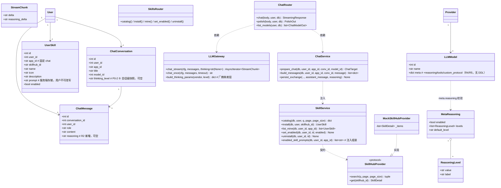
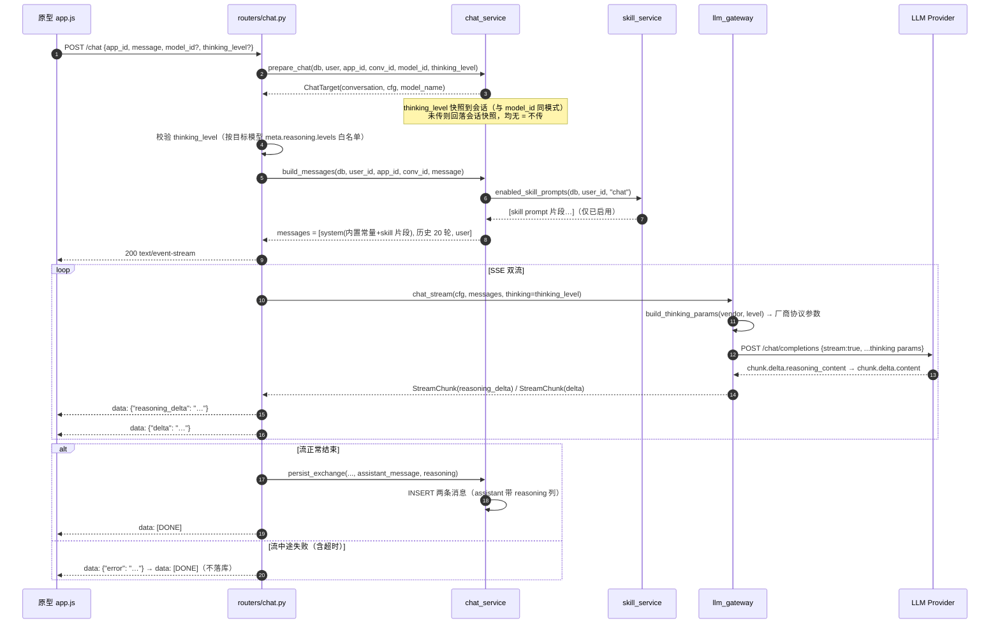
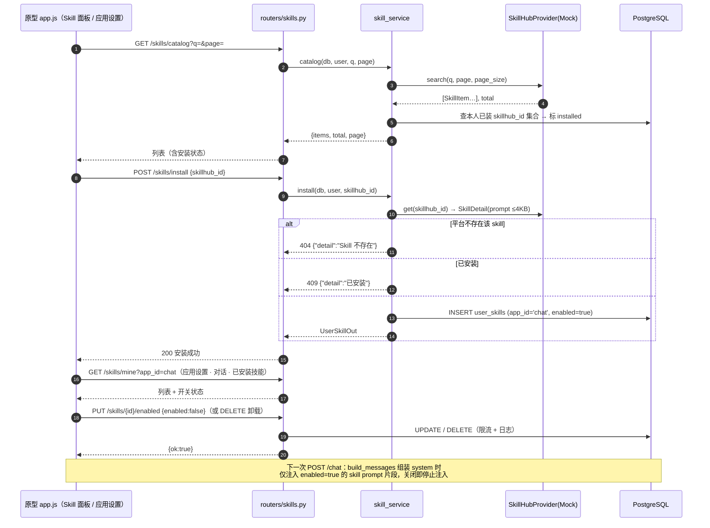
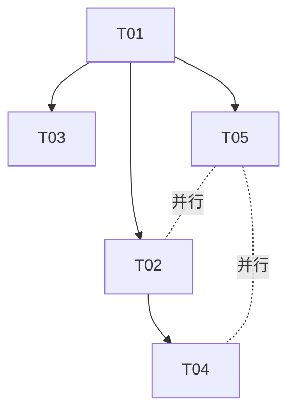

# 架构设计（增量）：对话思考模式 + 润色指令按钮 + Skill 接入 v1

> 版本：v1（2026-10-20）· 架构师：高见远（software-architect）
> 基准：《架构定稿-v1.md》（最高优先级）+《架构设计-v1.md》v1.4 +《PRD-v1.md》v1.1 +《PRD-增量-对话思考与润色-v1.md》v1.1
> 范围：本期增量 = 后端（网关思考双流透传 + 档位映射 + `POST /chat/polish` + SkillHub 代理契约 + skill 注入）+ Alembic 迁移（0003）+ 原型 prototype/v2（思维面板 / 强度选择 / 润色按钮 / 左侧功能列 / Skill 面板 / 管理端档位配置 / 应用设置已安装技能）
> 本期不动：账号/RBAC、模型管理主体、记账、文献、对外网关 `/gw/v1`、部署层。

---

## 修订记录

| 版本 | 日期 | 修订内容 |
| --- | --- | --- |
| v1 | 2026-10-20 | 初版：思考双流（R2/R3）+ 档位跟官方走（R5）+ 白名单唯一调用参数 `thinking_level`（R1）+ 润色接口 + SkillHub 代理契约（Mock 先行）+ user_skills 表 + 原型改造 + 任务分解 T01–T05 |
| v1.1 | 2026-10-22 | ① **Skill 存储升级为文件夹库**（业界 Agent Skills 开放标准）：skill = `skills/<slug>/` 文件夹 + `SKILL.md`（frontmatter `name`/`description`/`source`/`version` + 正文），文件夹为真相源、DB 仅存用户安装关系（索引/开关/顺序），**零新增迁移**；库根解析 `SKILL_LIBRARY_DIR` 环境变量（容器 `/app/skills`，本地项目根 `skills/`，docker-compose 挂 `./skills` 卷）；install 落盘 + name=slug 标记；enabled 注入读盘，目录被手动删除自动清理 DB 记录，升级前旧数据回退读 DB prompt（兼容分支，下版本可删）；uninstall 删记录 + 删目录；本地包（手工放入的合法 SKILL.md）自动出现在管理列表（来源=本地，只读）。② SkillHub 发现入口由侧抽屉改为**圆润中央弹窗** `#modal-skillhub`（modal-lg），`.skill-panel` 侧抽屉代码零残留；收藏/专家/MCP 占位维持 toast 不动（用户指示收窄）；`UserSkillOut` 增 `source`/`path`；Mock provider 的 SkillDetail 增 slug/version/SKILL.md 全文 |
| v1.2 | 2026-10-22 | **技能来源改为用户上传制（用户拍板）**：新增 `POST /skills/upload`（multipart，字段名 `file`；仅 .md、>64KB 422、frontmatter 缺 name/description 或无正文 422 中文 detail；slug 复用清洗；重名 409；落盘时 `source` 键统一置 `local-upload` 后写入 `skills/<slug>/SKILL.md` + 落库 name=slug、skillhub_id 占位 `local-upload:<slug>`，可开关/卸载且卸载删目录；`UserSkillOut.source` 增 `local-upload` 取值）。`#modal-skillhub` 重构为「我的技能」管理弹窗（上传按钮 + 隐藏 file input、搜索框改本地过滤已安装列表、列表含来源徽标 SkillHub/本地上传/本地）；应用设置「管理」入口与功能列 Skill 入口合并到此弹窗，旧 `#modal-skills` 模态框及其渲染/委托删除，hub 列表样式（.skill-row/.skill-name/.skill-desc）删除。SkillHub 平台接入保留预留：Provider 契约与 catalog/install/Mock provider 全部保留不动，自建 SkillHub 后再启用；新增依赖 `python-multipart`（requirements.txt）；前端 `API.skills.upload` 为独立 multipart fetch（不走 JSON 封装，Bearer + 401 处理与 request() 一致）；skills 写限流补 `rate_limit_enabled` 开关（与 auth.py 一致，测试环境关闭） |

---

## Part A 系统设计

### 1. 实现方案概述

**本期技术难点与对策：**

| 难点 | 对策 |
| --- | --- |
| 各家思考参数协议不同（DeepSeek `thinking.type` / OpenAI `reasoning_effort` / GLM `thinking.type` turn-level / Qwen `enable_thinking`+`thinking_budget` / Kimi `thinking.type`） | 网关新增 **per-vendor 映射层** `build_thinking_params(vendor, level)`，纯函数、表驱动；档位 value 由管理端按官方文档配置进 `meta.reasoning.levels`，网关只负责映射与消毒 |
| SSE 双流透传不破坏现有事件协议 | 现有 `{"delta"}` / `{"error"}` / `[DONE]` 不变，**新增事件类型 `{"reasoning_delta"}`**（R3）；`llm_gateway.chat_stream` 产出物由 `str` 升级为 `(delta, reasoning_delta)` 二元组，无思维流的上游自然不产出 reasoning 帧，前端面板自动隐藏 |
| `llm_models.meta` 固定结构扩展 | meta 列为 schemaless JSON（0001 迁移即 `sa.JSON()`），新增 `reasoning` / `tools` / `custom_protocol` 键 **无需 DDL、无需迁移**；仅 `chat_messages.reasoning` 列与 `user_skills` 表需要迁移 0003 |
| SkillHub 平台 API 未就绪（PRD Q7） | **契约先行、Mock 可替换**：定义 `SkillHubProvider` 协议（search / get），本期交付 `MockSkillHubProvider`（内置演示 skill 集，prompt ≤4KB），真实 API 接入仅为替换实现类，路由与表结构不变 |
| skill prompt 注入安全（N-增5） | prompt 仅来自 SkillHub（或管理员录入）且**服务端存储、用户不可改写**；安装/卸载写接口限流 + 日志；注入位置固定在 system 组装处，内置常量在前、skill 片段在后 |
| 2核4G 约束 | 不引入任何新进程/中间件；全部改动落在既有 FastAPI 进程内 |

**架构模式**：沿用经典分层 Router → Service → Model。新增两个服务模块：`skill_service`（skill 生命周期 + 注入片段组装）与 SkillHubProvider 抽象；网关保持纯函数式（调用方查库传 `ClientCfg`，网关不查库）。

**本期无新增第三方依赖**（详见 §6）。

### 2. 文件列表

```
backend/
├── alembic/versions/0003_thinking_and_skills.py      # 新增：chat_messages.reasoning 列 + user_skills 表
├── app/models/chat.py                                # 改：ChatMessage 增 reasoning 列 + ChatConversation 增 thinking_level 快照列
├── app/models/skill.py                               # 新增：UserSkill ORM
├── app/models/__init__.py                            # 改：导出 UserSkill（Alembic env 依赖）
├── app/schemas/chat.py                               # 改：ChatRequest.thinking_level / ChatMessageOut.reasoning /
│                                                     #      ChatModelOut.reasoning / PolishIn / PolishOut
├── app/schemas/skill.py                              # 新增：CatalogQuery / SkillItemOut / SkillInstallIn / UserSkillOut
├── app/schemas/llm.py                                # 改：MetaReasoning（Pydantic 结构校验，管理端 PUT /models/{id} 用）
├── app/services/llm_gateway.py                       # 改：chat_stream 双流 + build_thinking_params() 厂商映射
├── app/services/chat_service.py                      # 改：build_messages 注入 skill 片段 + persist_exchange 存 reasoning
├── app/services/skill_service.py                     # 新增：catalog/install/mine/toggle/uninstall + enabled_skill_prompts() 注入组装
├── app/services/skillhub.py                          # 新增：SkillHubProvider 协议 + MockSkillHubProvider + get_provider() 工厂
├── app/routers/chat.py                               # 改：SSE reasoning_delta 事件 + POST /chat/polish + thinking_level 校验
├── app/routers/skills.py                             # 新增：GET /skills/catalog + POST /skills/install +
│                                                     #      GET /skills/mine + PUT /skills/{id}/enabled + DELETE /skills/{id}
├── app/routers/admin_models.py                       # 改：模型 meta 更新接口接入 MetaReasoning 校验（档位列表增删行）
└── app/main.py                                       # 改：注册 skills 路由

prototype/v2/
├── assets/js/api.js                                  # 改：无（stream 已按 JSON 事件分发，reasoning_delta 自然兼容）——仅 bump ?v=
├── assets/js/app.js                                  # 改：思维面板渲染 / 强度选择 / 润色按钮 / 左侧功能列 / Skill 面板 /
│                                                     #      管理端档位配置 / 应用设置已安装技能
├── assets/css/main.css                               # 改：思维面板 / 强度行 / 功能列 / Skill 面板样式
└── index.html                                        # 改：应用设置弹窗增「已安装技能」行；?v= bump

docs/
└── 架构设计-v1.md、架构定稿-v1.md、PRD-v1.md         # 改：契约文档同步 + 修订记录（T05 交付）
```

> `prototype/v2/assets/js/data.js` 不改动（页面数据已全走真实 API）。

### 3. 数据结构与接口

#### 3.1 meta.reasoning 结构（Pydantic 校验）

```python
# app/schemas/llm.py
class ReasoningLevel(BaseModel):
    value: str = Field(min_length=1, max_length=32)   # 协议透传值：off/high/max/32768…（官方原样）
    label: str = Field(min_length=1, max_length=32)   # 展示用官方命名：高/超高、think-high…

class MetaReasoning(BaseModel):
    enabled: bool = False
    levels: list[ReasoningLevel] = Field(default_factory=list)
    default_level: str | None = None                  # 必须是 levels 中一项（校验器）

    @field_validator("default_level", mode="after")
    @classmethod
    def _in_levels(cls, v, info):
        if v and info.data.get("levels") and v not in {x.value for x in info.data["levels"]}:
            raise ValueError("default_level 必须是 levels 中的一项")
        return v

class ModelMeta(BaseModel):
    """llm_models.meta 固定结构（Q16 + R4/R5）：新增 reasoning/tools/custom_protocol。"""
    context: str | None = None
    vision: bool = False
    files: bool = False
    reasoning: MetaReasoning | None = None            # 无该键 = 不支持思考（enabled=false 等效）
    tools: bool = False                               # R4 预留位：本期只落数据不落功能
    custom_protocol: bool = False                     # R4 预留位：同上
```

- **存取**：meta 列为 JSON（0001 迁移 `sa.JSON()`，PostgreSQL 上为 schemaless JSON）→ 新增 `reasoning` 键 **无需 DDL、无需迁移**；管理端保存时整体读出 → Pydantic 校验 → 整体写回（JSON 合并语义：服务端以请求体为准合并顶层键，不回退历史键）。
- 兼容：旧数据 meta 无 `reasoning` 键 → 读出时按 `None` 处理 → 前端「不显示任何强度 UI」（P0-2 ④）。

#### 3.2 chat_messages/chat_conversations 增列 + user_skills 表（Alembic 0003）

```python
# alembic/versions/0003_thinking_and_skills.py（命名惯例沿用 0001/0002：四位序号_ snake_case）
revision: str = "0003";  down_revision: str = "0001"   # 与 0002 并行分叉由工程线 merge，或顺序 down=0002（推荐后者，保持单链）

def upgrade() -> None:
    op.add_column("chat_messages", sa.Column("reasoning", sa.Text(), nullable=True))  # R2：思维全文，可空
    # P0-2 ⑤：会话级 thinking_level 快照（R1 边界②：仅会话级，无全局默认、无管理页覆盖值）
    op.add_column("chat_conversations", sa.Column("thinking_level", sa.String(32), nullable=True))
    op.create_table(
        "user_skills",
        sa.Column("id", sa.Integer(), primary_key=True),
        sa.Column("user_id", sa.Integer(), sa.ForeignKey("users.id", ondelete="CASCADE"), nullable=False),
        sa.Column("app_id", sa.String(32), nullable=False, server_default="chat"),  # 安装位置固定 chat（用户拍板）
        sa.Column("skillhub_id", sa.String(64), nullable=False),   # SkillHub 平台 ID / mock id
        sa.Column("name", sa.String(64), nullable=False),
        sa.Column("icon", sa.String(64), nullable=False, server_default=""),
        sa.Column("description", sa.String(256), nullable=False, server_default=""),
        sa.Column("prompt", sa.Text(), nullable=False),            # 服务端存储，用户不可改写（N-增5）
        sa.Column("enabled", sa.Boolean(), nullable=False, server_default=sa.true()),
        sa.Column("installed_at", TZ, nullable=False, server_default=sa.func.now()),
        sa.UniqueConstraint("user_id", "app_id", "skillhub_id", name="uq_user_skill"),
    )
    op.create_index("ix_user_skills_user_app", "user_skills", ["user_id", "app_id", "enabled"])
```

- 表数：21 → 22 张。用户维度（Q9 已决：用户级全局，装上即对全部对话生效，可开关）。

##### 3.2.1 Skill 文件夹库（v1.1 起为真相源；Agent Skills 开放标准）

存储业界标准对齐 Anthropic Agent Skills：skill = 文件夹 + `SKILL.md`（YAML frontmatter `name`/`description`/`source`/`version` + 正文指令）+ 可选 scripts/references/assets。Claude Code 用 `~/.claude/skills/`、WorkBuddy 用 `~/.workbuddy/skills/`，本项目统一用**项目根 `skills/`**（api 容器 `/app/skills`，compose 挂 `./skills:/app/skills`）。

- **真相源**：已安装 skill 的指令正文只从 `skills/<slug>/SKILL.md` 读取；`user_skills.prompt` 列保留（旧数据兼容用，下版本可删），表结构不变、**零新增迁移**；
- **install**：provider.get() 拉包（SkillDetail 含 slug/version/SKILL.md 全文）→ 清洗 slug → 写 `skills/<slug>/SKILL.md`（已存在 409）→ `user_skills` 记录（`name=slug` 作文件夹库时代标记）；
- **enabled 注入**：库中正文 ∩ DB enabled；目录缺失且 `name=slug`（手动删除）→ 自动清理 DB 记录；目录缺失且 `name=展示名`（升级前旧数据）→ 回退读 DB prompt（兼容分支，下版本可删）；
- **uninstall**：删记录 + 删 `skills/<slug>/`（单用户场景直接删；多用户引用计数预留）；
- **本地 skill**：`skills/` 下手工放入的合法包（SKILL.md 且 `source` 非 `skillhub:*`）自动出现在管理列表（`source=local`、`id=0` 只读，不报错、不被误删）；「扫描注册」（登记 DB 获得独立开关）为预留扩展点；
- frontmatter 解析为手写轻量实现（只取四键 + 正文分界），**零新增 pip 依赖**。
- 思维链落库：流正常结束后随 assistant 消息一并落库；**建议上限 64KB 截断**（见 §10-Q3）。
- 会话级档位快照（P0-2 ⑤ / R1 边界②）：`POST /chat` 带 `thinking_level` 时快照到 `chat_conversations.thinking_level`（与 `model_id` 同模式，`prepare_chat` 内写入）；请求未带时回落会话快照；均无 → 不传（厂商默认）。切换只影响后续消息。

#### 3.3 SSE 事件协议（R3）

现有事件类型（不变）：`data: {"delta": "..."}` / `data: {"error": "..."}` / `data: [DONE]`

新增（R3）：

```
data: {"reasoning_delta": "先看一下这个问题…"}

data: {"delta": "答案是…"}

data: [DONE]
```

- 无思维流的模型**不产生** reasoning 帧 → 前端自然不渲染面板（P0-4 ②）。
- 流中途失败语义不变：`{error}` → `[DONE]`，已产生文字（含思维）不落库。

#### 3.4 POST /chat 请求体与厂商映射表

```jsonc
// 请求（在现有 {app_id, conversation_id?, message, model_id?} 上增一字段）
{ "app_id": "chat", "conversation_id": 12, "message": "…", "model_id": 3,
  "thinking_level": "high" }   // 可选；R1 白名单内唯一可开放调用参数；不传 = 厂商默认
// 快照语义：传入即覆盖会话快照（chat_conversations.thinking_level），只影响后续消息（P0-2 ⑤）
```

**校验规则**（路由层，返回 SSE 前完成，沿用现有架构）：
1. `thinking_level` 为字符串、≤32 字符（消毒）。
2. 目标模型 `meta.reasoning.enabled=false` 或 meta 无 reasoning → **忽略该参数**（不报错，等价不传）。
3. `levels` 非空 → `thinking_level` 必须命中某个 `level.value`，否则 400。
4. `levels` 为空且 `enabled=true`（官方仅开关）→ 接受 `"on"` / `"off"`（或 `"enabled"`/`"disabled"`），其余 400。
5. mock vendor → 忽略。

**厂商映射表**（`llm_gateway.build_thinking_params(vendor, level) -> dict`，纯函数）：

| vendor | 映射 | 说明 |
| --- | --- | --- |
| deepseek | off→`{"thinking": {"type": "disabled"}}`；其余→`{"thinking": {"type": "enabled"}}` | DeepSeek thinking.type 仅 enabled/disabled 两态；档位语义（如 think-high）由官方模型自身决定 |
| openai | `{"reasoning_effort": "<value>"}`（value ∈ low/medium/high/xhigh 原样） | OpenAI 兼容系（含多数中转）默认走此参数 |
| glm | 同 deepseek 两态映射 | GLM turn-level thinking |
| qwen | `"off"`→`{"enable_thinking": false}`；纯数字→`{"enable_thinking": true, "thinking_budget": <int>}`；其余（如 "on"/"high"）→`{"enable_thinking": true}` | Qwen3 协议 |
| kimi | 同 deepseek 两态映射 | Moonshot thinking.type |
| custom | `{"reasoning_effort": "<value>"}` 原样透传 | OpenAI 兼容兜底 |
| mock | `{}` | 不产生任何参数 |

映射结果并入 `/chat/completions` 请求体顶层（R1 边界：仅此一个维度的调用参数可开放，temperature/max_tokens/top_p 仍一律不传，Q9 精神不变）。

#### 3.5 POST /chat/polish 接口契约

| 项 | 内容 |
| --- | --- |
| 路径 | `POST /chat/polish`（挂在 chat 路由下，权限同 `app:chat`） |
| 请求 | `{ "text": str }`（1–4000 字，Pydantic 校验） |
| 响应 | `{ "polished": str }` |
| 实现 | 复用 `route_service.resolve_default()` + `llm_gateway.chat_once`（**非流式**，与 `/money/parse` 同模式）；超时 ≤8s（N5），失败 502；基础限流（N14，沿用 money parse 的进程内限流写法） |
| 润色 prompt | **后端内置常量**（建议放 `chat_service.POLISH_SYSTEM_PROMPT`，与 Q14 同风格），要求：只改写润色、不回答问题、不改变原意、不解释；不可被用户输入覆盖（N-增2） |
| 模型 | 走网关**默认路由**（换模型零改动；见 §10-Q2） |

#### 3.6 SkillHub 代理契约（契约先行，Mock 可替换）

**后端接口**（`routers/skills.py`，全部 JWT 登录态；安装位置固定 `app_id=chat`）：

| 方法 | 路径 | 说明 |
| --- | --- | --- |
| GET | `/skills/catalog?q=&page=&page_size=` | SkillHub 列表（后端代理，避免前端跨域/暴露平台细节）；每条目含 `installed` 标记 |
| POST | `/skills/install` | `{skillhub_id}` → 经 provider.get() 拉取 skill 包 → 落库 `user_skills`；已装 → 409 |
| GET | `/skills/mine?app_id=chat` | 本人已安装列表（id/name/icon/description/enabled/installed_at） |
| PUT | `/skills/{id}/enabled` | `{enabled}` 开关；关闭即停止注入 |
| DELETE | `/skills/{id}` | 卸载（删除记录）；写操作限流 + 日志（N-增5） |

**SkillHubProvider 协议**（`services/skillhub.py`）：

```python
class SkillItem(NamedTuple):
    skillhub_id: str; name: str; icon: str; description: str

class SkillDetail(NamedTuple):
    skillhub_id: str; name: str; icon: str; description: str; prompt: str  # prompt ≤4KB（N-增5）

class SkillHubProvider(Protocol):
    async def search(self, q: str, page: int, page_size: int) -> tuple[list[SkillItem], int]: ...
    async def get(self, skillhub_id: str) -> SkillDetail | None: ...

class MockSkillHubProvider:
    """本期交付：内置 4–6 个演示 skill（含 prompt 片段，≤4KB）；
    真实 API 就绪后仅需替换 get_provider() 返回的实现类（集成点唯一）。"""

def get_provider() -> SkillHubProvider: ...  # 工厂：当前恒返回 Mock；读 settings.skillhub_base_url 非空则实例化真实实现（预留）
```

**已安装 skill 的注入**（`chat_service.build_messages` 组装处，激活 §7 预留注入点）：

```python
# 伪代码
system = SYSTEM_PROMPT                                    # 内置常量在前（Q14）
fragments = await skill_service.enabled_skill_prompts(db, user_id, app_id)  # 按 installed_at 升序
if fragments:
    system += "\n\n" + "\n\n".join(fragments)             # skill 片段在后；用户不可改写
```

- 注入内容为 skill 包内**预设 prompt 片段**；不占 R1 白名单（非调用参数，是 system 片段）。
- 关闭开关 → 下次请求即不再注入；卸载 → 删除记录。
- 专家（P2-1）未来复用同一注入通道，本期不建专家表。

#### 3.7 类图（Mermaid）



### 4. 程序调用流程

#### 4.1 带思考的对话流（时序图）



#### 4.2 Skill 安装 → 管理 → 注入生效流（时序图）



### 5. 原型改造要点（prototype/v2）

- **思维面板**：`renderChatMessages` 与 `sendMessage` 的流式回复节点中，assistant 消息体增思维区（默认折叠标题行「已深度思考（耗时 Xs）▸」，展开显全文灰阶弱化）；流式期间收到 `reasoning_delta` 只更新「思考中…」计时态，不逐字渲染（P0-1 ②，降感知延迟）；历史消息按 `reasoning` 字段渲染。折叠态记忆仅记最后一条消息是否展开（localStorage）。
- **强度选择**：`modelPool()` 数据透传 `capabilities.reasoning`；`.mp-pop` 模型项内按 `reasoning` 动态渲染强度行（多档按钮组 / 仅开关二态 / 不渲染三分支，P0-2）；选择绑定 `chatState.thinkingLevel`，`sendMessage` 请求体带 `thinking_level`；默认取 `default_level`。
- **润色按钮**：composer 工具条增魔棒按钮（输入非空且 ≤4000 字可点）；点击 → loading → `POST /chat/polish` → **直接替换 textarea 原文**、不自动发送；toast「已润色，Ctrl+Z 撤销」；存原文支持撤销一次；失败 toast 原文不动（P0-3）。
- **左侧功能列**：`.conv-panel` 头部下方增功能入口区（新建会话/收藏/专家/Skill/MCP）；仅 app_id=chat 显示；收藏/专家/MCP 点击「即将上线」占位（P1-3）；窄屏沿用 conv-panel 抽屉模式。
- **Skill 面板**：点击 Skill 入口打开侧层面板（搜索 + SkillHub 列表 + 安装状态 + 二次确认安装）（P1-4）。
- **应用设置**：`#modal-set-apps` 增「AI 对话 · 已安装技能」行 → 打开已安装管理弹窗（列表/开关/卸载）。
- **管理端**：提供商详情模型行 → 编辑模型 meta 时「思考模式」勾选升级为档位配置子表单（档位列表增删行：value+label；默认档下拉；工具调用/图片输入/自定义协议复选框标注「预留」）（P1-1）。
- **工程约定**：全部交互事件委托；改后 bump `index.html` 的 `?v=`；ES5 写法。

---

## Part B 任务分解

### 6. 依赖包列表

**本期无新增生产依赖**——双流解析、厂商映射、SSE 均复用现有 httpx / FastAPI；Pydantic 结构校验复用现有 pydantic 2.x。`requirements.txt` 不变。

### 7. 任务列表（按实现顺序，含依赖）

| 任务 | 内容 | 涉及文件 | 依赖 | 优先级 |
| --- | --- | --- | --- | --- |
| **T01 数据层：迁移 0003 + 模型 + Schema** | `chat_messages.reasoning` + `chat_conversations.thinking_level` 两列 + `user_skills` 表迁移（单链 down=0002）；ORM 更新；`ChatRequest.thinking_level` / `ChatMessageOut.reasoning` / `ConversationOut.thinking_level` / `ChatModelOut.reasoning` / Polish In-Out；`MetaReasoning` 结构校验器（default_level ∈ levels）；`schemas/skill.py` | `alembic/versions/0003_thinking_and_skills.py`（新增）、`app/models/chat.py`、`app/models/skill.py`（新增）、`app/models/__init__.py`、`app/schemas/chat.py`、`app/schemas/skill.py`（新增）、`app/schemas/llm.py` | — | P0 |
| **T02 思考双流 + 润色（后端核心）** | `chat_stream` 升级双流（StreamChunk）+ `build_thinking_params` 厂商映射表；`chat_service` 落 reasoning + 校验规则；SSE 增 `reasoning_delta` 事件；`POST /chat/polish`（内置润色 prompt 常量 + ≤8s + 502 + 限流）；mock vendor 双流行 | `app/services/llm_gateway.py`、`app/services/chat_service.py`、`app/routers/chat.py`、`app/schemas/chat.py`（随 T01 结构补方法） | T01 | P0 |
| **T03 SkillHub 代理 + skill 管理接口** | SkillHubProvider 协议 + MockSkillHubProvider + 工厂集成点；`skill_service`（catalog/install/mine/toggle/uninstall + 注入组装）；`routers/skills.py` 五接口（限流+日志）；`build_messages` 接入注入；`main.py` 注册路由 | `app/services/skillhub.py`（新增）、`app/services/skill_service.py`（新增）、`app/routers/skills.py`（新增）、`app/services/chat_service.py`、`app/main.py`、`app/schemas/skill.py` | T01（可与 T02 并行） | P1 |
| **T04 原型对话页改造** | 思维面板（折叠/计时/历史/流式态）+ 强度选择（弹层动态档位）+ 润色按钮（替换+撤销）+ 左侧功能列（占位入口）+ Skill 面板 + 应用设置已安装技能 + `?v=` bump | `prototype/v2/assets/js/app.js`、`prototype/v2/assets/css/main.css`、`prototype/v2/index.html`、`prototype/v2/assets/js/api.js` | T02（思维/润色依赖后端契约；功能列/Skill 面板与 T02 无强依赖） | P0/P1 |
| **T05 管理端档位配置 + 契约文档同步** | 管理端模型 meta 档位配置子表单（P1-1，含官方 fetch-models 预填钩子）+ `admin_models.py` 接入 MetaReasoning 校验；**三份契约文档同步**：PRD R1–R5 + 系统提示词注入决策（skill 注入点激活）落《架构设计-v1.md》修订条目与 Q18+、《架构定稿-v1.md》修订4、《PRD-v1.md》§4.6 事件协议与请求体 | `prototype/v2/assets/js/app.js`、`prototype/v2/index.html`、`app/routers/admin_models.py`、`docs/架构设计-v1.md`、`docs/架构定稿-v1.md`、`docs/PRD-v1.md` | T01（Schema）；T04 可并行 | P1（文档同步为强制交付项） |

依赖关系：`T01 → T02 → T04`；`T01 → T03`；`T05` 依赖 T01（与 T02/T04 并行）。`alembic upgrade head` 单链：0003 的 down_revision 取 0002。

**验收标准摘要**：P0-1～P0-4、P1-1～P1-4 按 PRD 增量文档逐条验收；T02 需含 mock vendor 双流回归测试（reasoning_delta 事件序列 + reasoning 落库 + polish 超时 502）；T03 需含注入开关生效测试。

### 8. 共享知识（跨文件约定）

| 项 | 约定 |
| --- | --- |
| SSE 事件命名 | JSON 键即事件类型：`delta` / `reasoning_delta` / `error` / `[DONE]`；新增类型只增不改 |
| thinking_level 协议值 | 透传值原样来自 `meta.reasoning.levels[].value`（官方命名，如 `off`/`high`/`max`/`32768`）；label **仅展示用，官方命名原样展示不翻译**；不传 = 厂商默认 |
| meta 合并 | meta 为 schemaless JSON，增键无 DDL；管理端保存 = 请求体顶层键整体合并写回，不回退旧键；`reasoning` 整体替换（不做 levels 行级合并） |
| system 注入 | 内置常量 `SYSTEM_PROMPT` 在前，skill 片段按 `installed_at` 升序以 `\n\n` 拼接在后；用户不可改写；仅 `enabled=true` 且 `app_id=chat` |
| skill prompt | ≤4KB（安装时校验，超出 400）；服务端存储，任何接口不回写编辑 |
| 错误响应 | 沿用 `{"detail": "…"}` + 标准状态码；polish 超时/上游失败 502；thinking_level 不在白名单 400；skill 已装 409 |
| 落库 | SSE 期间落库用独立 `SessionLocal()`（沿用 §9.1）；reasoning 与 assistant 消息同事务落库；流失败不落库 |
| 原型 | ES5、事件委托、`?v=` bump、设计参考火山方舟/Arco + LobeChat + DeepSeek 双流（AGENTS.md） |
| 隔离 | `user_skills` / reasoning 均按 user_id 行级隔离；reasoning 不出现在 `/gw/v1` 等对外接口（N-增1） |

### 9. 任务依赖图



### 10. 待明确事项

| # | 事项 | 默认决策（可先行） |
| --- | --- | --- |
| Q1 | SkillHub 真实 API 的字段与鉴权方式 | MockSkillHubProvider 先行（契约已冻结：search/get 两方法 + SkillDetail 四字段）；平台侧答复后仅需替换工厂实现 |
| Q2 | polish 的模型路由 | 走网关**默认路由**（与 `/money/parse` 一致，换模型零代码）；若用户期望「润色用便宜模型」则后续批次再议 |
| Q3 | 思维链落库长度上限 | 建议 64KB 截断（超出截断 + 日志）；历史回看注入厂商时**不带 reasoning**（文本已够，避免协议兼容问题） |
| Q4 | 多轮历史是否把 reasoning 回注厂商 | **不回注**（文本已够，避免各家对 assistant reasoning_content 兼容性差异）；DeepSeek 兼容的 reasoning_content 回注排后续批次 |
| Q5 | 管理端 fetch-models 按厂商预填档位 | 本期在拉取接口中内置**厂商默认档位映射表**（deepseek→高/超高…）作为 meta.reasoning 初始值，管理员可改；预填表随官方文档演进手工维护 |
