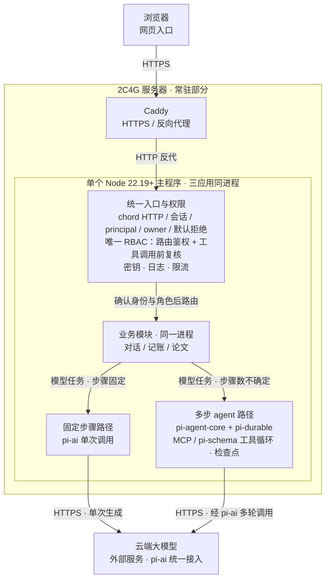
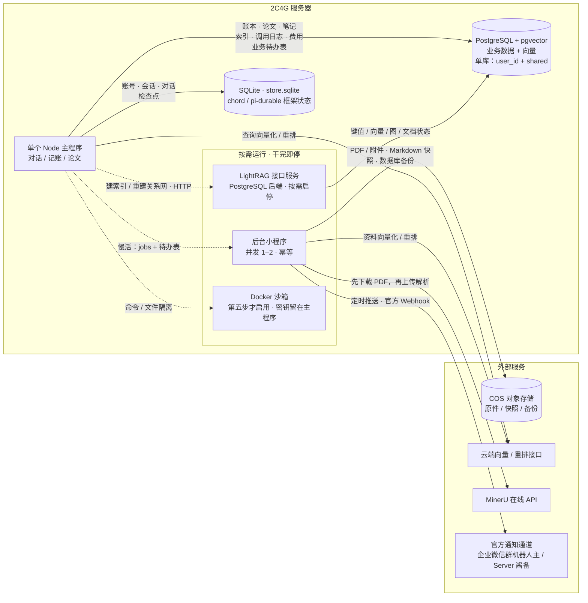
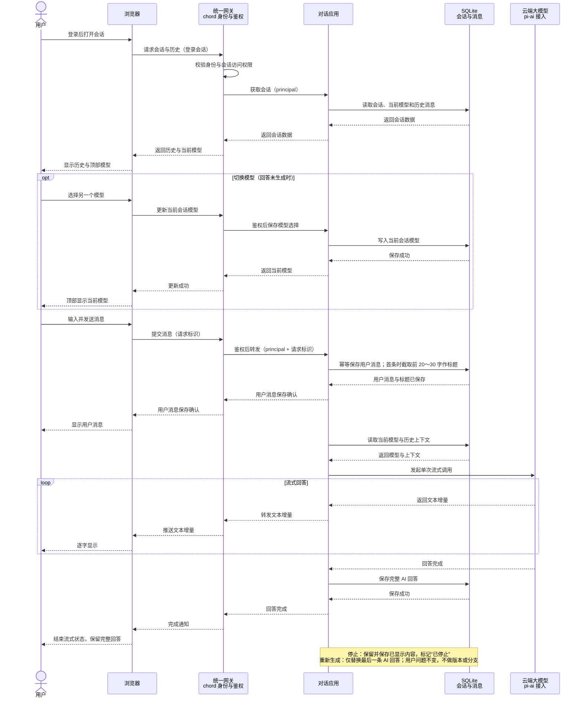
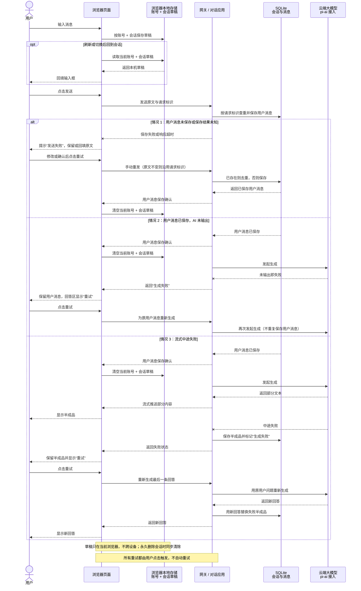
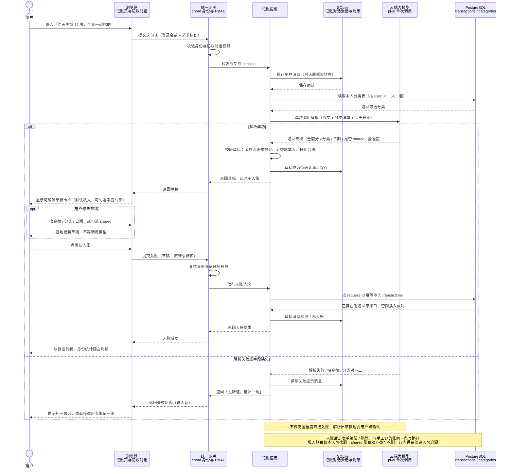
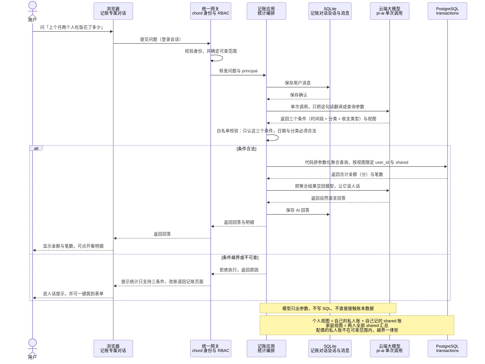
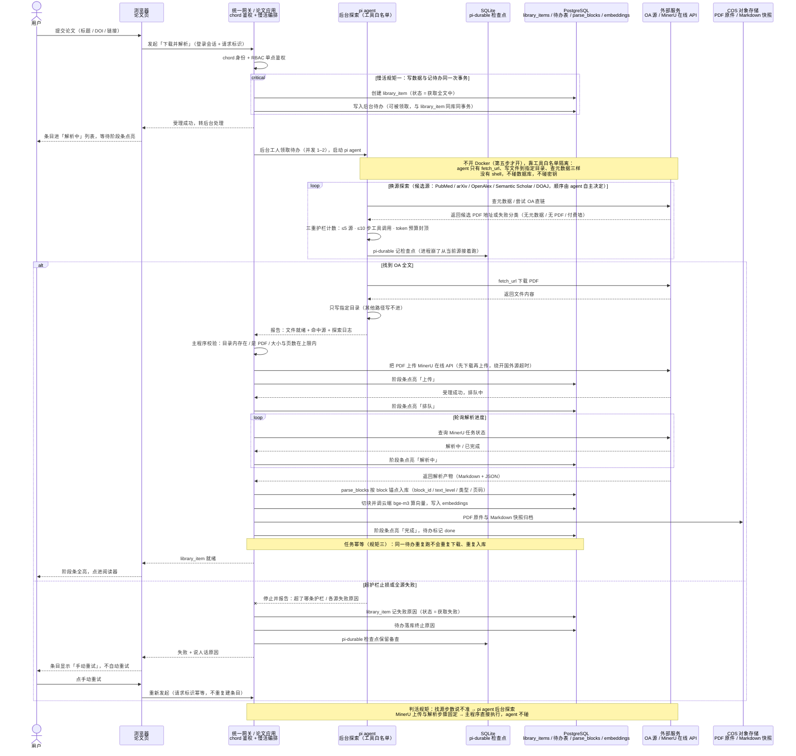
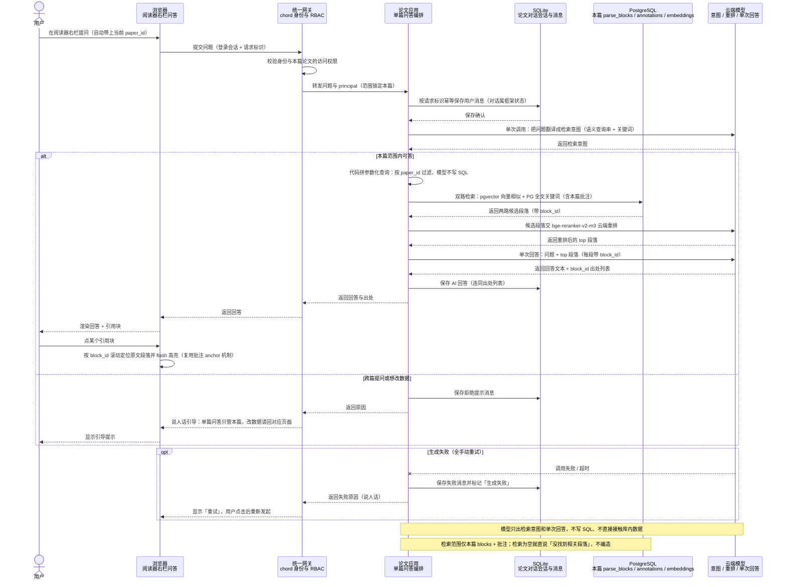
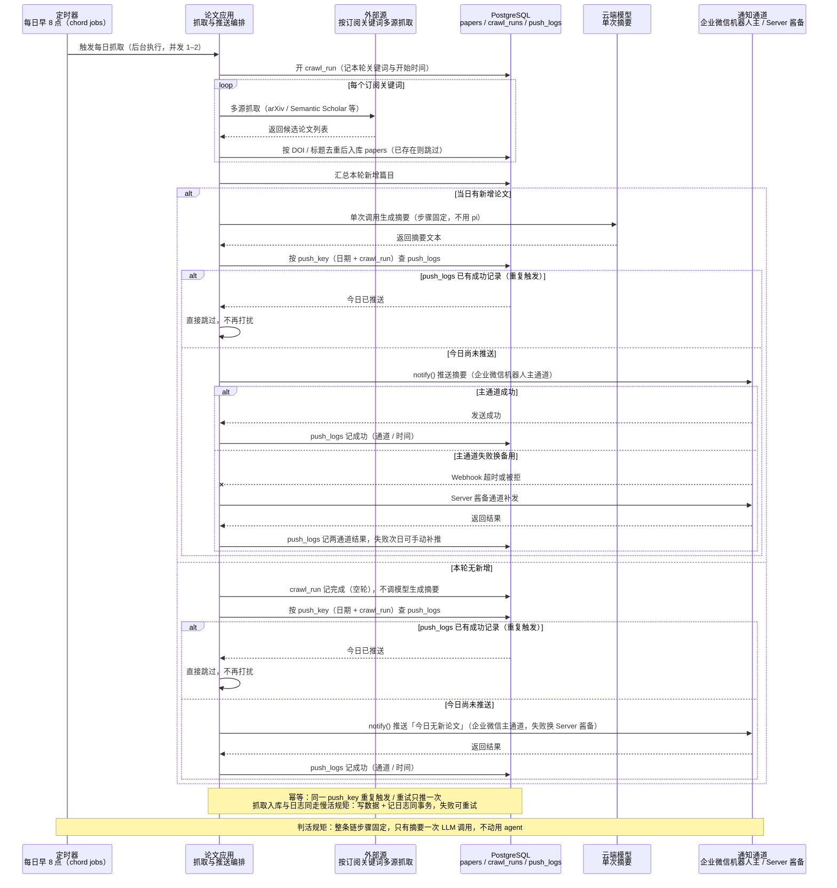
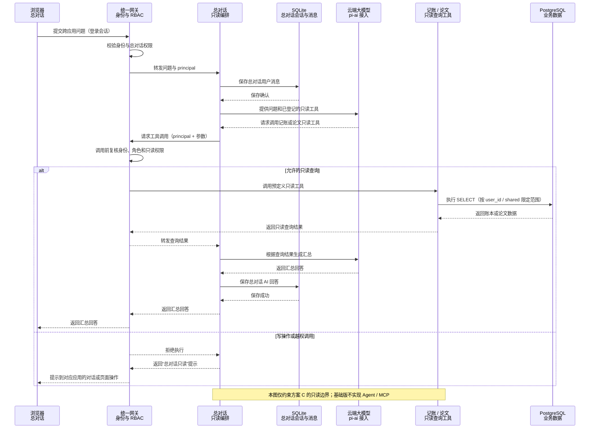

# 流光咖啡馆 · 白皮书 v3（个人 Agent 工作台）

> 状态：**讨论稿**（存储分层 Q1、文档归属 Q6 已拍板；其余 ★ 条目见 §16）
> 生成时间：2026-11-10，最近更新 2026-11-14
> 上游讨论稿：`docs/pi-workbench-architecture.html`（架构说明大白话版 v1.2，已降为参考件）
> 旧版处置：白皮书 v2 已删除，备份在 `.workbuddy/backup-docs-20261110/`（该目录不进 git）

---

## 00 这份文档干什么用

v2 是基于 Python + PostgreSQL + Hatchet 那套写的，跟新架构不是一回事，所以整份重做。

v3 的地基是 `pi-workbench-architecture.html`。这份白皮书在它上面补三样东西：

1. **pi 全家桶到底有什么**——逐个包核实官方说明，列清楚哪些用、哪些不用（§03）
2. **官方明确不管的事**——权限、角色、存储后端（§04），这几条直接决定我们要自己写多少
3. **2C4G 上的增补与裁剪**——哪些软件常驻、哪些按需、哪些不要（§07、§15）

规矩沿用项目约定：任何产品决策、架构变更、新应用立项，先改这份文档再动手。

---

## 01 一句话定位

一台 2C4G 服务器，装一个主程序，里面跑三个应用（对话、记账、论文），共用一套登录，大模型全部调云端。

---

## 02 硬件与红线

**机器**：2 核 CPU、4G 内存、70G 硬盘，外加一个 COS 网盘。两个人用。

**真正的瓶颈是 CPU 和"同时只能一个地方写"**，不是内存。大模型、向量计算都在云上，本机只收发文字。

**明确不做**：

- 本机跑大模型、本机跑向量模型
- Redis、Celery、RabbitMQ、Kafka 这类消息队列
- 独立向量库常驻（Qdrant、Milvus、LanceDB 服务）
- Elasticsearch、RAGFlow（官方就要 4 核 16G）
- 微信个人号当正式入口（无官方接口，非官方登录会封号）

**运行环境**：pi 要求 Node.js 22.19 以上。

### 环境基线（2026-11-13 拍板，本地开发与 2C4G 生产共用）

本地开发与 2C4G 生产用同一套版本基线，两端一致，避免「我这能跑」。版本号钉死，升级一律人工读 changelog（沿用 §14 升级纪律，不追新）。

| 组件 | 钉死版本 | 选型理由 | 备注 |
|---|---|---|---|
| Node.js | 24.22.3（精确） | 24 线安全支持到 2028-04；22 线 2027-04 EOL 太短；26 刚转 Active LTS（2026-10-28）按不追新纪律缓用，2027 年中评估迁移 | 原 engines `>=22.19.0` 继续有效，24 满足 |
| PostgreSQL | 18.7 | 2026-11-12 修复 52 个 CVE（含高危 CVE-2026-6460），官方支持至 2030-11 | 必须 18.7+，18.6 及以前有未修高危漏洞 |
| pgvector | 0.8.7 | 支持 PG 13–18，修复 HNSW vacuum 索引损坏 | 与 PG 同一镜像 `pgvector/pgvector:0.8.7-pg18-bookworm`，版本天然同步 |
| pi / chord 全家桶 | 1.5.2（精确锁定） | npm 当前最新即 1.5.2 | 发版极快，升级一律人工读 changelog |
| Docker Desktop | 4.99.0 | 当前稳定版；要求 WSL ≥ 3.0.3 | 生产 Linux 裸装 docker engine，按镜像 tag 对齐 |
| 系统镜像底 | bookworm（Debian 12） | postgres / pgvector 官方维护 | 两端一致 |
| COS | 开发期本地目录 mock | 基础版对话用不到 COS（PDF 归档 / 备份属 3b 与运维） | 环境变量开关 `STORAGE_DRIVER=local/cos`，密钥只进 `.env` 不入库 |
| SQLite | chord 自带 | 纯框架状态零安装 | — |

**施工提示（写给未来施工会话的三条硬提醒）**：

1. **PG 18 镜像数据卷挂载路径已变**：挂 `/var/lib/postgresql`（不是旧教程的 `/var/lib/postgresql/data`），挂错丢数据。锚点命令：
   `docker run -d --name pg -e POSTGRES_PASSWORD=<口令> -v pgdata:/var/lib/postgresql -p 5432:5432 pgvector/pgvector:0.8.7-pg18-bookworm`
2. **容器起好后必须验**：`SELECT version()` 显示 18.7、`CREATE EXTENSION vector` 显示 0.8.7（18.7 改了扩展 ABI，镜像底层若还是 18.6 需换浮动 tag 或自建镜像）。
3. **Node 用 nvm-windows 管理**（本机已有 v22.22.2 不冲突），`nvm install 24.22.3` + `nvm use`。

**待定两条**（如实记录，未定不猜）：COS mock 接口边界——3b 开工前定；备份脚本落地时间——生产部署前必须落地。
**已定一条**（2026-11-14）：LLM provider 密钥渠道——多家可配（pi-ai 按 OpenAI 兼容接口逐家配置，密钥只进 `.env` 不入库），**DeepSeek 官方为第一家**；具体配置项第 1 批开工时随对话应用定稿。

**搭建步骤**（装 WSL2 → Docker → Node → 起 PG 容器 → 装依赖配 `.env` → 验证）全文不进白皮书，避免运维手册把产品契约文档撑臃肿；按本清单执行即可，docker run 锚点命令见上。

---

## 03 pi 全家桶清单（2026-11-10 核实官方 README）

pi 是一个开源大仓库（`github.com/earendil-works/pi`，原 `badlogic/pi-mono`），MIT 协议，TypeScript。

**关键点：pi 不是一个软件，是一堆可以分开拿的代码包。** 需要哪层引哪层，不装它的命令行工具，也不往里塞插件。

### 七个包，逐个说

**`@earendil-works/pi-ai` —— 用**

统一的大模型接口。官方列出的能力：

- 30 多家厂商：OpenAI、Anthropic、Google、DeepSeek、MiniMax、Moonshot、Qwen、xAI、OpenRouter、Groq、Cerebras、Bedrock、Vertex AI、Mistral、GitHub Copilot，以及"任何 OpenAI 兼容接口"（Ollama、vLLM、LM Studio）
- 流式输出，事件分得很细：文本增量、思考过程增量、工具调用参数增量、开始、结束、出错
- 工具调用（也就是让模型说"我要调哪个工具、参数是什么"），参数用 JSON Schema 校验
- 提示缓存和会话亲和：同一个会话重复问，厂商那边能少算钱
- 模型目录：内置一份，也能动态刷新拉最新
- **token 和费用统计**：输入、输出、缓存读、缓存写分开记，还能区分"厂商报的账"和"按目录价估的"
- 遥测指标：请求耗时、首字耗时、token 数、费用

对我们的用处：**这就是网关的核心**。换厂商只改配置，费用统计现成，不用自己写。

**`@earendil-works/pi-agent-core` —— 用**

"想一步做一步"的运行时，建在 pi-ai 上。官方列出的能力：

- 完整的事件流：开始、每一轮开始结束、每条消息开始结束、工具执行开始/进度/结束
- 工具执行两种模式：并行（默认）和串行
- **插话（steering）**：模型正在跑工具时，你可以插一句"停，改做这个"
- **排队（follow-up）**：模型快干完时，你把下一件事排上
- 两个钩子：`beforeToolCall`（工具执行前拦一道，可以拒绝）、`afterToolCall`（结果出来后加工）
- 上下文处理：`transformContext` 用来裁剪老消息、压缩长对话
- 思考档位：off / minimal / low / medium / high / xhigh / max，还能配 token 预算
- 自定义消息类型：界面上要显示的东西可以塞进对话记录，发给模型前过滤掉

对我们的用处：**对话应用的 agent 模式靠它**。`beforeToolCall` 这个钩子正好用来做"调工具前再查一次角色"。

**`@earendil-works/chord` —— 用（部分）**

对象运行时，管"几个应用怎么装进同一个程序"。官方列出的能力：

- **契约**：每个对象类型有名字、参数、版本，用 JSON Schema 描述
- **引用而非对象**：拿到的是引用，本地和跨进程用起来一样
- **文档**：带事务的 JSON 值，对象自己拥有
- **jobs**：比调用它的那次请求活得久的活
- **principal**：每次调用都带"现在是谁"，对象按人分开存
- **热替换**：程序跑着的时候换掉某个插件的代码，一台一台换
- HTTP 层：路由、认证器、默认开启的安全基线
- worker：按需起、闲了就停的子进程
- 存储：`openStore`、`defineTable`、查询、导出导入
- 客户端：网页版和终端版
- 可选 React 绑定

**`chord/app` 这个入口额外给的**（这是选它的主要原因）：

- `startServer` / `startWorker`
- **会话**：浏览器会话、设备会话、临时会话三种；令牌只存哈希，定长时间比较；cookie 有效期 400 天
- **主人登录**：一次性链接（10 分钟有效）+ 本地令牌文件
- **设备配对**：手机扫码那种，四段码，主人批准
- **可选插件**：`defineUsers`（按 id 管账号）、`inviteFacet`（主人发 7 天一次性邀请链接）、`ephemeralLoginFacet`（临时登录）
- 本地文件存储、数据导出导入
- **HTTP 默认拒绝**：没身份的路由直接 401，除非显式声明公开

对我们的用处：**登录、账号、会话、邀请全现成**，这是自己写要好几天的活。

> **✅ 已实测验证（2026-11-11）**：在项目外临时目录装了 chord@1.5.2（npm 直连可装、0 漏洞），写最小 `startServer` 脚本真跑通——服务器正常启动、打印出带 token 的一次性主人登录链接（`http://127.0.0.1:PORT/_chord/owner#<token>`）、owner 端点 200 而其余路由默认 401、正常关闭无报错。`defineUsers`/`inviteFacet`/`Sessions` 等账号能力均在 `chord/app` 实际导出中确认存在。**地基靠得住，白皮书 §04 的判断（有登录账号地基、无现成 RBAC）经实跑证实。** 验证目录已删，未污染项目。
>
> 版本现状（2026-11-11 核实）：chord / pi-ai / pi-agent-core / pi-durable / pi-schema 全线 **1.5.2**（架构文档里记的 1.5.0 已小升）；Node 引擎要求 `>=22.19.0`，本机 v22.22.2 满足。`chord/app` 入口需补两个可选依赖 `esbuild`（构建插件）+ `ws`（WebSocket）才能用，已确认装上即可。

**`@earendil-works/pi-durable` —— 用（2026-11-11 拍板）**

可恢复的对话和任务运行时。官方原话：**"Experimental. The API changes without notice between releases."**（试验品，版本之间接口会变，不另行通知）

能力：

- 对话是一份只增不改的记录，每步都先写库再显示
- **任务是有检查点的状态机**：进程崩了，重开能从上次的点接着跑
- 原子提交：追加消息、改文档、建任务，要么全成要么全不成
- 内置文档：agent 配置、厂商会话标识、正在跑的生成和工具、排队的输入、花费统计
- 上下文压缩、重置、分叉
- 存储后端：内存、浏览器 IndexedDB、SQLite、JSONL 文件、Cloudflare Durable Object

对我们的用处：**论文下载那种长任务、崩了能接着跑，正是它管的**（2026-11-11 拍板：用）。两个顾虑这样应对：

1. **标着试验品** → 锁死版本，升级前先跑契约测试、看 changelog（沿用 §14 升级纪律）
2. **存储后端没有 PostgreSQL** → 不是问题。它管的是对话记录和任务检查点这类**框架状态**，正好落在 §05 方案 A 的 SQLite 那层，本来就不需要 PG；业务数据仍在 PG

**`@earendil-works/pi-schema` —— 用**

JSON Schema 构造器。chord 的契约和工具参数都拿它写。

**`@earendil-works/pi-telemetry` —— 观察**

厂商中立的遥测契约、参考适配器、一致性测试、类型化 schema。chord 自带一个 SQLite 遥测后端。第一步不用，等要看"哪次调用花了多少钱、慢在哪"时再接。

**`@earendil-works/pi-coding-agent` —— 不用**

终端里的编程助手。这是帮人写代码的工具，不是应用框架。当底座不行（架构文档 §03 已论证）。

**`@earendil-works/pi-tui` —— 不用**

终端界面库，差分渲染。我们做的是网页，用不上。

**`earendil-works/pi-chat`（另一个仓库）—— 第五步后再看**

接 Slack 和聊天软件的。等真要接企业微信/飞书/Telegram 时再评估。

### 引哪几个，一句话

第一步需要五个：`pi-ai`、`pi-agent-core`、`chord`、`pi-schema`、`pi-durable`（2026-11-11 拍板用，管对话记录 + 可恢复的长任务）。`pi-telemetry` 观察备用，`pi-coding-agent` / `pi-tui` 不用。

---

## 04 官方明确不管的事（决定我们要自己写多少）

这几条是从官方文档里逐字核实的，不是猜的。

**1. pi 没有权限系统。**

官方 README 原话大意：pi 不包含限制文件系统、进程、网络、密钥访问的内置权限系统；默认情况下，它以启动它的那个用户和进程的权限运行。如果需要更强的边界，就把 pi 装进容器或沙箱。

官方给了四种隔离方式（详见 §12）。

**2. chord 没有角色，也没有 RBAC。**

`chord/app` 里翻遍了没有 role、permission、RBAC 这些词。它给的是：

- `principal`：应用自己定义的身份类型，比如 `{ kind: "user", id: "zhangsan" }`
- `owner`：一个特殊身份，管登录链接、设备配对、发邀请
- HTTP 默认拒绝
- `authorize` 钩子：应用自己写"这个人能不能碰这个地址"

**所以"谁能删、谁能看"这些规则，必须我们自己写。** 架构文档 §11 估的量级是几天，这个估算成立——因为账号表、会话、身份贯穿、按人存数据、默认拒绝都有了，我们只补规则和一个管理页面。

**3. pi-durable 是试验品。**

官方自己写着接口会变、不另行通知。用它就得锁死版本，升级前先跑契约测试。

**4. chord 的存储只有 SQLite。**

`chord/app` 的数据目录长这样：

```
<datadir>/server/store.sqlite
<datadir>/workers/<kind>/<key>/store.sqlite
```

官方文档里没有出现 PostgreSQL。`pi-durable` 的五个存储后端是：内存、IndexedDB、SQLite、JSONL、Cloudflare Durable Object——**也没有 PostgreSQL**。

这条直接影响存储选型，见 §05。

**5. chord 的同步功能标着 experimental。**

跨设备同步那套先别指望。

---

## 05 数据存哪（2026-11-11 拍板：方案 A）

背景冲突：chord 和 pi-durable 的存储层只认 SQLite（§04 第 4 条），官方没有 PG 适配器；但业务侧要用 PG。结论是**分两层存，各用各擅长的**。

**框架状态 → chord 默认的 SQLite（2026-11-13 拍板修订）**

登录会话、账号、对话记录、pi-durable 任务检查点。这些是 chord 和 pi-durable 亲手管的，跟着官方走最省事，升级不容易断。文件就是 `<datadir>/server/store.sqlite`。

**业务待办从这份清单移出（2026-11-13 拍板修订）**：上面原写的清单里有「待办」，现在把它拆成两半——业务后台任务的待办表跟着业务数据走 PG，与业务数据同库，「写数据 + 记待办同一次事务」天然成立，不会丢活；纯框架状态（登录 / 会话 / 账号 / 对话记录 / pi-durable 任务检查点）仍留 SQLite 不动。

**业务数据 + 向量 → 一个 PostgreSQL（装 pgvector 扩展）**

账本、论文元数据、笔记、向量、检索索引、调用日志、费用统计。

为什么向量必须放 PG，不放 SQLite：

- SQLite 那套（sqlite-vec）是**挨个比**：1 万条瞬间，5 万条约 50 毫秒，**50 万条以上开始明显卡**
- PG 的 pgvector 有专门索引（HNSW，先粗筛再细比）：**百万条还是几毫秒**
- 我们的量级估算：2000 篇论文 × 每篇约 50 段 ≈ **10 万段向量**。SQLite 还能撑（约 100 毫秒/次）但已踩在临界点；PG 毫无压力
- **LightRAG 官方推荐的生产后端就是 PostgreSQL**，一个库能把它要的四类存储全担了（见 §11）。用 PG 当它的后端，它就不把数据集塞内存，进程能瘦到 100–200MB

关系数据（账本、论文信息、笔记）放 SQLite 其实不会慢——带索引的查询百万行也是几毫秒，两人规模到不了瓶颈。**真正会慢的只有向量检索这一项**，而它正好落在 PG 这层。

代价：两个库都要备份；跨库的"同一次操作要么都成要么都不成"做不到。但业务上很少需要——业务待办表与业务数据同在 PG，单库事务就能保证（2026-11-13 拍板修订）；剩下跨库的只有纯框架状态，它与业务数据之间没有强一致要求。

### 两个用户的数据怎么分

**用 `user_id` 区分，不分库。** 业务数据集中在一个 PG 库里，每条记录带 `user_id`，两人共看的打 `shared` 标签。

- chord 天生就这么设计：它的 `principal` 就是"现在是谁"，数据按人分
- PG 还能加"行级安全"（数据库自己保证你只查得到自己的行）
- 共享资料一个标签搞定，不用复制两份
- 资料地址按架构文档定的带上归属：`papers://{谁}/{哪条}`

**不分库的理由**：向量索引和关系网要在单库里才建得起来；分库会让共享数据无处安放。两人隔离靠 `user_id` + 网关那一处角色判断（RBAC 单点）足够。

### 没选的方案（留档）

- **方案 B 全 PG**：自己给 chord/pi-durable 写 PG 适配器，数周工作量，且 pi-durable 标着试验品、接口会变，适配器反复返工。跟"升级不痛苦"硬约束冲突，否
- **方案 C 全 SQLite**：最省内存（省下 PG 那 150–250MB），但向量检索在 10 万段量级已到 SQLite 临界点，且 LightRAG 用不了它推荐的 PG 后端。否

---

## 06 整体分几层

沿用架构文档 §04 的六层，中间那层是唯一要长期不变的：

1. **入口**：聊天软件 / 网页 / 命令行——随时能换
2. **让大模型干活**：pi-ai + pi-agent-core
3. **统一调用格式（MCP）★**：全项目唯一要长期保持不变的一层
4. **第一批三应用**：对话、记账、论文（后备：双链笔记、实验记录）
5. **找资料**：关键词 + 按意思找 + 重排 + 关系网
6. **存东西**：SQLite（框架状态）+ PG（业务数据和向量）+ COS（原件和备份）

**统一入口和统一格式是两回事，别混。** 入口管外面进来的请求（谁在用、什么角色、密钥放哪、记日志、限流、页面挂哪）；格式管内部几块之间怎么互相叫（每个应用能干什么、参数长什么样、升级时怎么确认没改坏）。

### 总体架构图：主请求链路（容器视图）



主图只回答“请求从哪里进来、在哪里鉴权、模型任务走哪条路”。三个应用是同一 Node 进程内的模块，不是三个独立服务；普通增删改查不强行经过模型，数据读写见下图。

### 数据与运行边界（补充视图）



**读图**：实线箭头表示调用或数据流，虚线箭头表示按需启动或派发，圆柱表示存储。LightRAG、Docker 和后台小程序都不常驻；**Redis / 消息队列不采用**，慢活走 chord jobs 框架侧调度 + PG 业务待办表（与业务数据同库同事务）。

画法依据：[C4 的视图分层](https://c4model.com/diagrams)、[C4 节点与连线规范](https://c4model.com/diagrams/notation) 和 [AWS 按逻辑运行位置划分边界](https://docs.aws.amazon.com/en_us/marketplace/latest/userguide/saas-guidelines.html)；图源遵循 [Mermaid Flowchart 官方语法](https://mermaid.js.org/syntax/flowchart.html)，便于后续在 HTML 中同步渲染。

---

## 07 实际开几个程序（2C4G 版）

**一直开着的，三样**

| 程序 | 干什么 | 大概内存 |
|---|---|---|
| 主程序（Node 22.19+） | 认人、分角色、发页面、管密钥、记日志；三个应用都装在它里面 | 0.8–1.4G |
| PostgreSQL + pgvector | 账本、论文、笔记、向量、日志；也是 LightRAG 的后端 | 0.15–0.25G |
| Caddy | 网址和加密 | 约 0.02G |

**叫了才来的**

| 程序 | 干什么 | 内存 |
|---|---|---|
| 后台小程序 | 下载论文找源、定时推送、把资料变成向量。干完就关，最多同时 1–2 个 | 0–0.3G |
| LightRAG（接口服务） | 建索引、重建关系网时起，用 PG 后端所以瘦，干完关 | 0 / 0.1–0.2G |
| Docker 小房间 | 第五步 agent 模式要跑命令改文件时才开 | 0.1–0.2G |

**在别人机器上的**：云端大模型、云端向量接口、COS 网盘、聊天软件。

**加起来**：

- **平时**（只有常驻三样）：约 1.5–2.3G，4G 内存留 1.7G+ 空闲
- **最忙时**（后台 + LightRAG 建索引 + Docker 全开）：约 1.8–2.9G，仍留 1G+，不碰交换区

**别给每个应用各开一个常驻程序**——2C4G 上太浪费。三个应用是装在同一个程序里的模块，互不干扰靠的是契约、各自的数据表、每次请求带"现在是谁"。

---

## 08 三个应用做什么（已拍板）

### 判活规矩（所有功能先过这一条）

**步骤数事先说不准的活，才值得动用 pi。** 比如"下载这篇论文，找不到 PDF 就换下一个源接着找"——让模型自己边做边决定下一步。

**步骤固定的活，直接一次调用大模型就完事。** 比如一句话变成一笔账、一段资料变成一篇摘要。更便宜、更稳、出错好查。

### 对话应用（打磨顺序 1、5）

**实施边界（2026-11-11 拍板）**：先做方案 A「普通对话基础版」，包含会话新建 / 重命名 / 删除、历史记录、模型选择、流式回答、停止与重新生成；先验证登录、模型调用和对话保存这条主线。方案 B「普通对话 + Skill / MCP / 工具调用 / agent 模式」不取消，完整保留到第五步实施，不在基础版里提前混入工具权限、任务恢复和沙箱问题。

**模型选择（2026-11-11 拍板）**：按会话生效。新会话使用系统默认模型；每个会话可单独换模型，切换只影响之后的回答，旧消息保持不变；回答生成时禁止切换；页面顶部显示当前会话所用模型。不做全局强制切换，也不在基础版做逐条消息选模型。

**会话列表（2026-11-11 拍板）**：采用基础实用版，包含新建、重命名、删除、按标题搜索，按最后对话时间倒序排列。置顶、归档、文件夹和标签暂不做，确有需求后再加。

**删除规则（2026-11-11 拍板）**：二次确认后永久删除，会话与全部消息一起删除，并明确提示不可恢复。基础版不做回收站、软删除和定时清理；若以后误删问题确实频繁，再单独评估恢复能力。

**会话标题（2026-11-11 拍板）**：发送第一条消息后，取消息前 20～30 个字自动生成标题，允许用户手动重命名；不为标题额外调用大模型。以后确有标题质量需求，再评估后台自动总结。

**停止与重新生成（2026-11-11 拍板）**：

- 用户停止后，已经显示的回答内容保留，标记为“已停止”，用户可继续发送下一条消息。
- 重新生成只针对最后一条 AI 回答；用户问题不变，新回答替换旧回答。
- 基础版不做回答版本管理，以后确有需求再加；不做分支会话。

### 普通聊天时序图：保存确认后再生成（基础版）



读图说明：打开会话先经网关校验身份，再从 SQLite 读历史与当前模型；用户消息必须先拿到保存确认才调用 pi-ai，首条消息在同一保存步骤截取前 20～30 字生成标题。

**失败重试与输入草稿（2026-11-11 拍板）**：

1. **用户消息尚未保存**：原文保留或回填输入框，提示“发送失败”，用户可修改后手动重试。
2. **用户消息已保存但 AI 未输出**：保留用户消息，不塞回输入框；回答区显示“生成失败”和“重试”。
3. **流式中途失败**：保留已显示内容，标记为“生成失败”，与主动停止的“已停止”区分；重试时用户问题不变，新回答替换失败半成品，不做版本或分支。
4. **手动重试与链路确认**：全部为用户点击后手动重试，不自动重试；页面错误提示说人话，详细原因记日志；发送链路需明确用户消息已保存的确认，并用请求标识避免超时重试造成重复消息。
5. **本地输入草稿**：草稿按账号和会话保存在当前浏览器，切换会话或刷新后恢复；确认用户消息保存成功后才清空；永久删除会话时同步清除对应本地草稿；不跨设备、不做服务端草稿表，清除浏览器数据后不能恢复。

### 失败重试与草稿恢复时序图：三种状态全手动重试（基础版）



读图说明：草稿按账号+会话存浏览器本地，刷新后恢复，保存确认才清空；请求标识保证幂等；三种失败状态全手动重试，不做版本或分支。

| 功能 | 用不用 pi | 说明 |
|---|---|---|
| 基础聊天体验 | 不用 | 对标 DeepSeek 网页版：会话列表、逐字显示、markdown 和代码高亮、停止 / 重新生成。走网关单次调用 |
| 默认技能包，可人为配置 | agent 模式用 | 每个会话有默认专家配置（一条 JSON），用户可以改模型、换技能包 |
| 可配 MCP 检索工具 | agent 模式用 | 把"搜资料"等外部工具按 MCP 格式挂进来，模型自己决定调不调、调几次 |
| agent 模式开关 | 这就是 pi 的主场 | 普通对话 = 单次调用；agent 模式 = pi 接管，想一步做一步 |

### 记账应用（打磨顺序 2）

| 功能 | 用不用 pi | 说明 |
|---|---|---|
| 传统记账为主 | 不用 | 表单增删改查，沿用现有原型（金额一律「分」，收入红支出绿） |
| 对话记账 | 不用 | 一句话 → 单次提取金额 / 分类 / 日期 → 入库。固定流程 |
| 对话统计 | 不用 | 「这个月吃饭花了多少」→ 把话转成查询参数 → 代码执行聚合。**不让模型自己写 SQL** |

**升级顺序（2026-11-11 拍板）**：记账内部分三小步依次落地。

1. **2a 传统记账主线**：Node 重写增删改查 + 统计，数据落 PG，金额一律「分」，收入红支出绿；同时补齐原型缺失的账目编辑 / 删除和月份切换。
2. **2b AI 记一笔**：单次 LLM 调用把一句话解析成账目草稿 → 用户确认后才入账；复用 2a 的写入接口和 request_id 幂等键。
3. **2c 对话统计**：绑定记账专属对话，自然语言 → 查询参数 → 代码聚合。

**2a 范围（2026-11-11 拍板）**：包含账目编辑 / 删除和月份切换，补全增删改查——「传统记账为主」是上表原话，改和删是基本盘，不算新增功能。

**分类体系（2026-11-11 拍板）**：

1. 预置一组常用分类：不可删除，可以改名、可以隐藏；改名 / 隐藏本期补实现（原型只有文案，没有实现）。
2. 用户可自建分类，自建分类可删除。
3. 分类按 user_id 每人一套，两人之间不共用。

**AI 记一笔（2026-11-11 拍板）**：解析出的是草稿（金额 / 分类 / 日期，带置信度），用户可以改，点确认才入账；不做高置信度直接入账。

### AI 记一笔时序图：先出草稿，点确认才入账（幂等）



读图说明：解析只出草稿不入账，改草稿不再调模型；确认入账复用与表单同一条写路径，靠 request_id 幂等防重复；解析失败说人话并引导补一句或改用表单。

**家庭账本（2026-11-11 拍板）**：做两人家庭账本，用于记共同开销。

1. shared 账目双方都可看、可改、可删；账目记录创建人和创建时间，可追溯。
2. 记一笔默认「仅自己」（私人账目），手动勾选「家庭账本」才标 shared，避免误共享。
3. 统计默认个人视图（自己的私人账目 + 自己记的 shared），可切换家庭视图（两人全部 shared 账目汇总）。

**预算提醒（2026-11-11 拍板）**：不做。白皮书从未提及；确有需求以后再加，推送通道可复用。

**月度报表（2026-11-11 拍板）**：沿用原型——分类汇总条形图 + 近 6 月收支趋势，页面内查看；不做 CSV 导出，不做月度小结。

**对话统计查询边界（2026-11-11 拍板）**：只支持「时间段 + 分类 + 收支类型」三个条件的聚合问答；不支持备注关键词搜索；继续遵守「不让模型自己写 SQL」。

### 对话统计时序图：模型只出三条件，代码执行聚合（方案 C）



读图说明：模型只把一句话翻译成「时间段+分类+收支类型」三条件与视图，白名单校验后由代码拼参数化聚合查询，聚合结果再交回模型说人话；越界条件在代码层拒绝并说人话引导回页面。

**数据落点（2026-11-11 拍板）**：账本数据落 PG，至少两张表。

1. transactions：user_id、amount_fen、type、category_id、note、occurred_on、created_at、request_id 幂等键、shared 标记、创建人可追溯。
2. categories：user_id、name、kind、built_in、排序、隐藏标记。
3. 金额一律「分」整数存储。

### 论文应用（打磨顺序 3、4）

| 功能 | 用不用 pi | 说明 |
|---|---|---|
| 论文下载 | **用（后台任务）** | 可能找不到文件、找不到 PDF 源，要不断换源探索。走慢活那条路 |
| 论文笔记 + 问答 | 问答不用；通读生成笔记走后台 | 问答 = 检索笔记和原文段落 → 单次回答（带出处点回原文） |
| 论文推荐（对话） | 先不用 | 检索 → 重排 → 解释推荐理由，流程固定 |
| 定时推送 | 不用 | 定时抓取 + 单次摘要 + 推送 |

**升级顺序（2026-11-11 拍板）**：论文应用在第 3 步内部分四小步、第 4 步内部分两小步，依次落地。

1. **3a 论文库主线**：Node 重写库管理 / 导入 / 元数据 / 删除，数据落 PG，沿用原型 UI 与接口契约，不用模型不用 pi；含旧 PG 论文数据迁移脚本。
2. **3b 全文获取 + 解析管线**：pi agent 探索下载 → MinerU 在线 API 解析 → blocks 产物入库 → COS 存原件 → 四段阶段条状态机。这一步第一次用上慢活三规矩——写数据 + 记待办同一次事务、后台并发 1–2、任务幂等，也用 pi-durable 任务检查点。
3. **3c 向量化 + RAG 检索**：切段 → 云端向量化 → pgvector 入库 → 向量 + 全文双路检索 → 云端重排。LightRAG 推迟到第 4 步以后。
4. **3d 笔记 + 单篇问答**：批注笔记 Node 重写 + 单篇问答带 block 级出处。§13 第 3 步验证线「问答带出处能点回原文」在此收口。
5. **4a 定时抓取 + digest；4b 微信推送**。§13 第 4 步验证线「失败可重试不重复」在此收口。

**下载引擎与止损（2026-11-11 拍板）**：保留上表「用 pi 后台任务」原话，由 pi agent 后台探索下载；配三重硬护栏——最多试 5 个源、最多 10 步工具调用、单次任务 token 预算封顶。超限即停并落库记原因，转手动重试。§15 第 3 项已同步修订。

**失败重试（2026-11-11 拍板）**：全手动重试。下载 / 解析失败落库记原因，页面给重试按钮，不自动重跑；对齐对话与记账的「全手动重试」先例。

**抓取源（2026-11-11 拍板）**：沿用原型 5 源——PubMed、arXiv、OpenAlex、Semantic Scholar、DOAJ；其余源在市场页灰显「待接入」，作为扩展位。

**下载隔离（2026-11-11 拍板）**：pi agent 下载只给白名单工具集——fetch_url、存文件到指定目录、查元数据；不给 shell 和任意命令。文件只写指定目录，由主程序校验后入库。不开 Docker，§12 的 Docker 沙箱仍留第五步；靠工具粒度隔离——这也解了「agent 需要隔离 vs Docker 在第五步」的冲突。

**MinerU 触发（2026-11-11 拍板）**：一律走 MinerU 在线 API，产物统一 block 锚点，批注 / 翻译 / 问答全依赖它；免费额度两人用不完。§16-Q4 已拍「用在线 API」，本次补定触发条件 = 一律走。

### 论文下载解析时序图：pi agent 护栏内换源探索，MinerU 解析入库（慢活）



读图说明：写 library_item 和记待办在同一次事务里落 PG（critical 块，待办表与业务数据同库），pi agent 只在工具白名单内换源探索，三重护栏超限即停、失败全手动重试；下载的文件只写指定目录、由主程序校验后才上传 MinerU 在线 API，解析产物按 block 锚点入 PG、原件归档 COS，四段阶段条随管线点亮并写入 library_items（业务数据，在 PG），pi-durable 检查点留在 SQLite、保证进程崩了能接着跑。

**向量与重排模型（2026-11-11 拍板）**：定为 `BAAI/bge-m3` + `bge-reranker-v2-m3`，做成 API 配置项；一选定不轻换，换 = 全量重算向量。§16-Q5 已拍「配置项」，本次补定具体型号。

**RAG 路线（2026-11-11 拍板）**：第 3 步先用 pgvector 向量检索 + PG 全文检索双路 + 云端重排，自拼几十行；LightRAG 推迟到双链 / 关系网真被需要时，最早第 4 步以后。§11 留的口子本次定型。

**问答入口与出处（2026-11-11 拍板）**：

1. 3d 先做单篇问答：阅读器右栏问答框，只检索本篇 blocks 和批注，出处点回原文。
2. 跨篇的论文专属对话（§09 方案 C）随 3d 之后或第 4 步再做。
3. 出处粒度为段落 block 级：点引用块在阅读器内闪烁定位，复用批注 anchor 机制——block_id 锚点、点引用跳原文、flash 高亮。

### 单篇问答时序图：双路检索加云端重排，出处点回原文段落（block 级）



读图说明：问题经网关鉴权后先幂等存进 SQLite（论文对话属框架状态），模型只把问题翻译成检索意图、最后出一次带 block_id 出处的回答，中间由代码拼参数化查询做 pgvector+全文双路检索（范围锁死本篇 blocks+批注）再云端重排；点引用块在阅读器内 flash 定位原文，复用批注 anchor 机制；跨篇或想改数据一律拒绝并说人话引导。

**笔记范围（2026-11-11 拍板）**：

1. 中英对照翻译：保留，随 3d 重写。原型已做、用户实际用过、自动翻译开关都在，砍掉是体验倒退；涉及翻译 API 费用。
2. AI 通读生成结构化笔记：推迟第 4 步或更后，批注笔记已是完整形态。
3. AI 解读按钮：保留。原型残留但用户要留，随问答上线后与问答共存或自然取代，本期不删。
4. 批注笔记本身：照原型重写。

**推送频率（2026-11-11 拍板）**：每日早 8 点固定推 digest——今日命中 N 篇、M 篇高相关、标题 + 一句话摘要列表；无命中也发「今日无新论文」；靠 push_logs 幂等防重复。通道沿用 §16-Q3（企业微信机器人主 + Server 酱备），不再议。

### 定时抓取推送时序图：每日早八点一轮，push_logs 幂等防重



读图说明：定时器触发后台抓取（慢活并发 1–2），按订阅关键词多源抓取、去重入 papers；有新增才调一次模型做摘要，空轮不调模型生成摘要，但照发「今日无新论文」，同样按 push_key 幂等防重；notify 走企业微信机器人主通道、失败换 Server 酱备；push_logs 按 push_key（日期+crawl_run）查重，重复触发不再打扰。

**论文库共享（2026-11-11 拍板）**：默认私人，可逐篇勾选 shared 共享单篇，对齐记账的「默认私人手动共享」；批注 / 笔记按 user_id 分开，各写各的。

**数据落点（2026-11-11 拍板）**：PG 需新建多表，本条只记决策，建表和写代码放到实施时。

1. papers：论文元数据，pmid / doi 作去重键，含标题、作者、期刊、年份、被引、IF≈、摘要、abstract_zh、tags。
2. library_items：库内归属与状态，user_id、parse_status / phase / error、fulltext_status / error、needs_reparse、shared 标记。
3. parse_blocks：解析产物，block_id、text_level、类型、页码。
4. annotations：批注笔记，anchor_block_id、anchor_quote、body、双链 links、user_id。
5. translations：翻译缓存，block_id → 译文、状态。
6. embeddings / chunks：pgvector 向量与切段。
7. subscriptions：订阅配置（2026-11-13 拍板，独立建表，不沿用 settings 键）——订阅关键词、数据源、推送频率 / 开关、user_id 归属、创建时间。
8. crawl_runs：抓取记录与分源计数。
9. push_logs：推送记录，防重复。
10. PDF 原件、Markdown 快照、数据库备份放 COS；检索索引留本地硬盘；pi-durable 任务检查点放 SQLite，后台任务待办表放 PG（与业务数据同库同事务，2026-11-13 拍板修订，见 §05、§16-Q17）。

---

## 09 对话怎么组织（方案 C，已拍板）

**每个应用绑自己的对话 + 保留一个总对话。**

记账页面里的对话只挂记账工具，论文页面里的对话只挂论文工具——工具集窄而准，模型不容易选错，权限也清晰。

跨应用的问题（「我买论文这个月花了多少钱」）走总对话，它挂检索 + 各应用的**只读**查询工具。

业界成熟形态全是这个模式：Claude 的 Projects、Open WebUI 的 workspace、ChatGPT 的 GPTs，本质都是"一组上下文绑定一个会话"。

**派生一条硬规矩：总对话里挂的应用工具一律只读。** 改数据的动作必须回到应用自己的对话或页面里做，避免一句话误改两个应用的数据。

### 总对话只读查询时序图：写操作在网关拒绝（方案 C 边界）



读图说明：模型想调什么工具不算数，网关在调用前复核身份、角色和只读权限；查询按 user_id/shared 限定范围；本图是方案 C 边界说明，基础版不实现 Agent/MCP。

---

## 10 慢活怎么办（没有 Redis 也能行）

**慢活不走问答那条路。** 导入 PDF、批量导入、重算索引、定时同步，统统丢后台。

三条规矩：

1. **写数据和记待办放在同一次数据库操作里**——要么都成功，要么都不算。不然会出现"论文记下了、活没派出去"。落地说明（2026-11-13 拍板）：待办表与业务数据同在 PG，单库事务即可保证这条规矩，无跨库问题
2. **同时最多跑 1 到 2 个**，不够再调
3. **同一个任务重复跑不能出乱子**（幂等）

不这么做的话，聊天消息等不到结果就超时，两个人一起导入还会把 2 核 CPU 占满。

**待办筐用 chord 的 jobs + 数据库待办表，不用 Redis。** 两个人、一天几个慢活，够了。待办表落在 PG（与业务数据同库，2026-11-13 拍板，见 §05）；chord jobs 的框架侧调度状态仍在其 SQLite。

**什么时候才真需要消息队列**：一秒几十上百个活、好几个程序抢着领。你到不了。

### 其他并发硬线

- 同时问大模型最多 2 个
- 算向量最多 1–2 批
- 写索引排队一个一个来

---

## 11 找资料怎么做（RAG）

RAG 说白是开卷考试：先翻自己的资料，摘几段相关的，连同问题发给云端模型答，而不是让它凭记忆瞎编。

| 干什么 | 一开始用 | 不够了再换 |
|---|---|---|
| 按意思找相似内容 | PG 的 pgvector 插件 | 真到十万段以上再议 |
| 按关键词找 | PG 全文检索（中文要配分词） | Meilisearch |
| 算向量、重排 | 都调云端接口：`BAAI/bge-m3` + `bge-reranker-v2-m3`，或阿里云 `text-embedding-v3` + `qwen3-rerank` | — |
| 关系网 / 双链 | 先把 `[[链接]]` 当成"谁连着谁"记下来 | 用 LightRAG 本体（PG 后端、按需启停），见下 |

**中文必须两种一起用。** 光按意思找，遇到金额、编号、日期、实验批次这种精确的东西会找不准。

**向量模型做成 API 配置项**（2026-11-11 拍板）：不写死在代码里，配置里填「厂商接口地址 + key + 模型名」。**但一旦选定不轻易换**——换模型要把全部资料的向量重算一遍。**具体型号已定（2026-11-11 补拍，见 §08）**：向量 `BAAI/bge-m3` + 重排 `bge-reranker-v2-m3`；阿里云 `text-embedding-v3` + `qwen3-rerank` 落为备选候选，不启用。

**COS 网盘只放三样**：原始 PDF 和附件、笔记的 Markdown 快照、数据库定期备份。检索索引放本地硬盘——网盘不适合反复随机读写。

### LightRAG 怎么处理（2026-11-11 核实官方 README 后定）

核实过：`HKUDS/LightRAG` 是 MIT 协议（41k star，EMNLP 2025 论文），**法律上允许抄、改、商用，留个原作者声明就行**。

**它要四类存储**，官方默认实现全是内存型（原话：整个数据集待在进程内存里，本地文件只用来存档，容量被内存卡死，只适合测试不适合生产）：

| 存哪类 | 装什么 | 默认实现 |
|---|---|---|
| KV | 大模型回答缓存、切好的文本段、抽出的实体和关系 | JsonKVStorage |
| 向量 | 文本段、实体、关系的那串数字 | NanoVectorDBStorage |
| 图 | 知识关系网（谁连着谁） | NetworkXStorage |
| 文档状态 | 处理过哪些文档的清单 | JsonDocStatusStorage |

这就是"内存大户"的来源——默认配置下资料越多吃得越凶（300–500MB 起）。

**关键转折：官方推荐生产环境用 PostgreSQL，一个库能担下上面全部四类存储。** 这跟 §05 定的"业务数据 + 向量用 PG"正好合流——用 PG 当 LightRAG 后端，它就不把数据集塞内存，进程能瘦到 100–200MB。

**结论：用本体，包成接口服务，按需启停。**

- **包接口**：它本来就自带接口服务模式，起来就是个网址，主程序（Node）通过网络喊它。Node 和 Python 通信没有任何障碍——之前说"不能一起用"是错的，真正约束只是"别常驻"
- **按需启停**：建索引、重建关系网时拉起来，干完关掉，平时零内存
- **跟着上游升级**（用户提出，成立）：它修 bug、优化性能，升个版本号就拿到，比自己重写再自己维护划算

**用本体必须守三条：**

1. **向量和模型全部走云端接口**，绝不让它加载本地模型（一加载 2–4G，直接爆）
2. **后端配成 PostgreSQL**，不用它默认的内存存储
3. **锁死版本**，升级走既有的"先评估再升"流程

如果第 3 步动手后发现只用得上它两个想法（按意思找 + 顺着关系网找、长文先压摘要），自己在 PG 里写几十行也行。

**RAG 路线定型（2026-11-11 拍板，见 §08）**：上面留的口子本次定型——第 3 步（3c）先用 **pgvector 向量检索 + PG 全文检索双路 + 云端重排**，自拼几十行，不引 LightRAG；LightRAG 本体推迟到双链 / 关系网真被需要时再上，最早第 4 步以后。

---

## 12 危险动作怎么关起来

pi 官方不管文件和进程权限（§04 第 1 条）。所以除了账号角色，还要补：

- 每次调用都带"现在是谁"；数据本来就按身份分开存，取的时候再筛一遍
- 资料地址里带上是谁的，比如 `notes://{谁}/{哪条}`
- 专家配置里写死"能用哪些工具、能看哪些资料"，**调用前再查一遍角色**（用 pi-agent-core 的 `beforeToolCall` 钩子）
- 能共享的东西用标签标出来，别靠猜
- 密钥只放在主程序里，不跟着进沙箱
- 每次调工具都记一笔日志

### 官方给的四种隔离方式

| 方式 | pi 跑在哪 | 隔离什么 | 密钥怎么办 |
|---|---|---|---|
| Plain Docker | 容器里 | pi、内置工具、命令、扩展 | 密钥也进容器 |
| Docker Sandboxes | 托管沙箱 | 同上 | 密钥留主机，代理替换 |
| OpenShell | 本地或远程沙箱 | 同上 | 策略控制 |
| Gondolin 扩展 | 主机 | 只有内置工具和 `!` 命令 | 密钥留主机，但环境变量会漏进虚拟机 |

**我们第五步再开，前四步不请。** 因为前四步（基础聊天、记账、论文问答）全是查库和调云端接口，没有跑命令改文件的活，本来就安全。

**注意 Gondolin 那条**：官方自己写着命令会继承主机的环境变量，所以通过环境变量传的密钥在虚拟机里看得见。别拿它当密钥边界。

---

## 13 打磨顺序（已拍板）

1. **对话应用基础版**——一切的地基，先把"会话绑定应用"的结构立起来
2. **对话记账 + 对话统计**——单次调用，量级小，快速见效
3. **论文下载 + 笔记 + 问答**——把"找资料"那层建起来，是论文域核心
4. **定时推送**——在第 3 步的库上加成
5. **对话 agent 模式（pi + 技能包 / MCP 配置）**——最强也最重，前四步已把工具都注册好了

排序逻辑：从依赖少、见效快的往前走；pi 相关的最重的一步放最后。

### 每步验证什么

| 步 | 验证 |
|---|---|
| 1 | 整条线跑通；两个人分别登录，成员进不了管理页面 |
| 2 | 一句话记一笔入库正确；「这个月吃饭花了多少」对得上账 |
| 3 | 下载探索任务能换源重试；问答带出处能点回原文 |
| 4 | 到点抓取、摘要、推送，失败可重试不重复 |
| 5 | 切到 agent 模式能自主多步干活；前四步的工具都能在总对话里被调到 |

---

## 14 升级纪律

1. **调用格式一改就把版本号加一**，哪怕只是多一个字段。再写个自动检查：拿老版本的调用例子跑一遍，看新版本还能不能正常回答
2. **版本写死**，钉成 `@1.2.3`，锁在 lockfile 里，禁 `latest`
3. **升级顺序固定**：先只改那个"唯一引用 pi 的地方"→ 跑自动检查 → 过了才升
4. **pi-durable 标着试验品**，用它就必须锁版本 + 升级前先看 changelog
5. **升级前先出影响面评估**（沿用项目既有纪律）：依赖树波及、changelog 破坏性、锁版本 diff、回退方案。不做裸升

### 就认两条验收线

- **加新应用，核心一行都不用改**
- **换大模型供应商、或者换找资料的方式，应用一行都不用改**

整个架构绕这一圈，就是为了这两条成立。

---

## 15 2C4G 上的增补与裁剪

### 要补的六块（架构文档没写透）

**1. 前端形态**
沿用 `prototype/v2` 的形态：单页应用（hash 路由）+ 静态文件由主程序直接发。零额外进程、零额外内存。设计参考规则（AGENTS.md 第一节）继续有效。

**2. PDF 解析管线 → 用 MinerU 在线 API（2026-11-11 拍板）**

2C4G 上**绝不本地跑 MinerU**：本地版（`pip install mineru`）虽支持 CPU，但要下载几个 G 的模型、解析时吃满 2 核，直接拖垮整机。用它的**在线 API**（mineru.net，申请免费 token）。

核实到的关键限制（必须写进流程，否则第 3 步会踩）：

- **在线 API 只接受国内能访问的网址**——官方文档明写 github、aws 等国外源会请求超时。而论文很多来自 arXiv（国外）。**所以流程是：后台任务先把 PDF 下载到本地 → 再把文件上传给 MinerU API**，不能把 arXiv 链接直接丢给它
- 免费额度按页计（每天上千页量级，足够两人用）；单文件有大小/页数上限，超长的要分段
- 它能精准还原公式（转 LaTeX）、表格（转 HTML）、多栏排版、扫描件 OCR，输出 Markdown + JSON，正好喂给后面的切段和向量化
- 这是第 3 步（论文笔记 + 问答）的前置件

**3. 论文下载的探索源清单和止损规则（2026-11-11 修订拍板）**

原定「定死源顺序（arXiv → Semantic Scholar → Unpaywall → 出版商）、最多试几个源」，现改为：**pi agent 后台探索 + 三重硬护栏**——最多试 5 个源、最多 10 步工具调用、单次任务 token 预算封顶；超限即停并落库记原因，转手动重试。不设护栏 agent 会无限探索烧钱，这条不变。失败分类（无元数据 / 有元数据无 PDF / 付费墙）照旧落库。源范围沿用原型 5 源，详见 §08 论文应用拍板块。

**4. 推送通道 → 落到微信，但走官方通道（2026-11-11 拍板）**

你要的是"消息推到微信"。这里有个**必须避开的坑**：

- **不能用个人微信号自动化**。你提到参考 OpenClaw 的 IM 模块——我查了，OpenClaw 接微信走的是"个人号扫码登录"（逆向协议），多个来源一致警告：微信无官方个人号 API，逆向方案随时失效、要 24 小时挂机、**有封号风险**。它的 Telegram/WhatsApp 通道很成熟，但微信这条不能抄
- **能落到微信又不封号的只有官方通道**，按推荐排序：

| 方案 | 落在哪 | 门槛 | 免费额度 | 评价 |
|---|---|---|---|---|
| **企业微信群机器人** | 企业微信群（可建只有自己的单人群） | 注册企业微信（个人可注册，不需真有公司）+ 建群加机器人 | 免费，约 20 条/分钟 | **首选**：官方 Webhook，一条 HTTP POST 就发，稳定不封号，可加签防刷 |
| Server 酱 / PushPlus | 个人微信（关注它的服务号） | 扫码拿 SendKey/token | 每天几条到两百条 | 备选：接入最快（3 分钟），但额度小、依赖第三方 |
| Telegram Bot | Telegram | 找 BotFather 拿 token | 免费无限 | 最省事最稳，但你说要落微信，且国内访问不稳 |

**推荐：企业微信群机器人当主通道**（官方、免费、稳定、落微信），Server 酱当备用通道。代码上做一个统一的 `notify()` 接口，内部可随时切通道——通道相关代码一行都不进核心（沿用架构文档 §14 纪律）。

AstrBot 这种大框架先不用，两人规模一个 Webhook 调用就够。

（注：OpenClaw / Octop 这类框架的**架构思路**仍可参考——消息路由、通道适配层、配对白名单——只是它的个人微信通道不能照搬。）

**5. 部署与备份**
Caddy 保留（HTTPS + 反代）；**主程序打成镜像随 compose 跑**（2026-11-14 拍板修订：用户要求服务器环境干净，不用 systemd 直跑；compose 三件套 = Caddy + 主程序 + PG，部署文件 0C 后补在 `deploy/`）；SQLite 和 PG 定时备份到 COS，要落成具体脚本，不能只是"有备份"一句话。

**6. 数据迁移脚本**
现有 PG 里的账本和论文数据，如果表结构变了要能导过去。两人规模数据量小，一个脚本的事，但要写进第 0 步。

### 砍掉或推迟的六样

**1. chord 的"热替换"——不依赖**

先说清这是什么：**程序跑着的时候，把某个模块的代码换掉，不用关掉重开。** 官方叫 reload，一台一台主机换，尽量让数据、连接、正在跑的活都活着。

**跟登录没关系。** 登录状态是存在库里的（chord 的会话存 `store.sqlite`，cookie 有效期 400 天），所以**重启程序你也不用重新登录**。

它省的是"重启那几秒的停机"。几百人用才怕停；两个人用，重启几秒没人察觉。偏偏这又是 chord 最新、最容易出怪问题的部分。

**2. 独立向量库——全缓**
pgvector 够用。Qdrant、Milvus、LanceDB 服务都是为几十万上百万条准备的。

**3. Redis / 消息队列——不要**
见 §10。

**4. 本机模型 / RAGFlow / Elasticsearch——不要；LightRAG——可包接口按需启停（见 §11）**
见 §02、§11。

**5. Docker 常驻沙箱——第五步再开**
见 §12。

**6. 旧栈删除（2026-11-11 拍板，Q7）**

项目要按新架构重构，旧的 Python 栈整体删除：

- **删**：`backend/`（FastAPI 全部）、`pi-runner/`（旧的 Node 薄层 + 旧 SDK 形态）、`deploy/`（旧 compose 覆盖层、Hatchet/pi 配置）、`docker-compose.yml`（旧六服务编排）、根 `Caddyfile` / `Caddyfile.dev`（绑旧 api 容器）、`.env` / `.env.example`（旧变量）、`.ruff_cache/`（Python 缓存）
- **留**：`prototype/`（前端原型，新栈继续用）、`docs/`、`skills/`、`AGENTS.md`、`LICENSE`、`.gitignore`、`.workbuddy/`
- **区分清楚**：删的是旧**代码**，不是 PG 这个**技术**——方案 A 里业务数据仍用 PostgreSQL + pgvector，只是由新栈（Node/chord）来连，旧的 FastAPI ORM 和 Alembic 迁移作废重写
- **可恢复**：删除前已打包备份到 `E:/backups/`；且这些文件都在 git 历史里，`git log` / `git show` 随时能翻回来。数据层面，旧 PG 库里的账本/论文真实数据若要保留，迁移脚本在重构第 0 步单独处理（§15 要补的第 6 块）

---

## 16 未决问题清单

| 编号 | 问题 | 状态 |
|---|---|---|
| Q1 | 存储分层选 A / B / C 哪个 | ✅ 已定方案 A（框架态 SQLite + 业务态 PG/pgvector，LightRAG 用 PG 后端），见 §05 |
| Q2 | pi-durable 用不用 | ✅ 用（管对话记录 + 可恢复长任务；锁版本，状态落 SQLite 层），见 §03 |
| Q3 | 推送通道 | ✅ 落微信走官方通道：企业微信群机器人主 + Server 酱备；**不用个人号逆向（封号）**，见 §15 第 4 项 |
| Q4 | PDF 解析用哪家 | ✅ MinerU **在线 API**（不本地跑）；先下载 PDF 再上传（绕开国外源超时），见 §15 第 2 项；**触发条件 = 一律走在线 API（2026-11-11 补拍，见 §08）** |
| Q5 | 向量模型 | ✅ 做成 API 配置项；一选定不轻易换（重算成本），见 §11；**具体型号已定：`BAAI/bge-m3` + `bge-reranker-v2-m3`（2026-11-11 补拍，见 §08）** |
| Q6 | 文档归属：架构 html 和这份白皮书谁是主 | ✅ 白皮书 v3 为产品契约主文档，架构 html 降为讨论稿/参考，见 §00 |
| Q7 | 现有 Python 后端和 pi-runner 怎么处置 | ✅ 删除（项目重构，新栈不依赖旧代码）；已备份到 E:/backups，git 历史也可恢复，见 §15 第 6 项 |
| Q8 | 论文下载引擎怎么止损（2026-11-11） | ✅ pi agent 后台探索 + 三重硬护栏（≤5 源 / ≤10 步 / token 预算封顶），超限即停落库记原因，见 §08、§15 第 3 项 |
| Q9 | 论文下载失败怎么重试（2026-11-11） | ✅ 全手动重试：失败落库记原因，页面给重试按钮，不自动重跑，见 §08 |
| Q10 | 定时抓取用哪些源（2026-11-11） | ✅ 沿用原型 5 源（PubMed / arXiv / OpenAlex / Semantic Scholar / DOAJ），其余市场灰显「待接入」，见 §08 |
| Q11 | 下载 agent 怎么隔离（2026-11-11） | ✅ 白名单工具集（fetch_url / 存指定目录 / 查元数据），不给 shell；不开 Docker（仍留第五步），靠工具粒度隔离，见 §08 |
| Q12 | RAG 路线先用哪条（2026-11-11） | ✅ 先 pgvector 向量 + PG 全文双路 + 云端重排（自拼几十行）；LightRAG 推迟到双链 / 关系网真被需要时，见 §08、§11 |
| Q13 | 论文问答入口与出处粒度（2026-11-11） | ✅ 3d 先做单篇问答（阅读器右栏），跨篇专属对话随后或第 4 步；出处为段落 block 级，复用批注 anchor 机制点回原文，见 §08 |
| Q14 | 论文笔记范围（2026-11-11） | ✅ 中英对照翻译保留随 3d 重写；AI 结构化笔记推迟第 4 步或更后；AI 解读按钮保留；批注笔记照原型重写，见 §08 |
| Q15 | 论文推送频率（2026-11-11） | ✅ 每日早 8 点固定推 digest，无命中也发「今日无新论文」，push_logs 幂等防重复；通道沿用 Q3，见 §08 |
| Q16 | 论文库共享规则（2026-11-11） | ✅ 默认私人，逐篇勾选 shared 共享单篇（对齐记账先例）；批注 / 笔记按 user_id 各写各的，见 §08 |
| Q17 | 业务待办存 PG 还是 SQLite（2026-11-13） | ✅ 待办放 PG：与业务数据同库，「写数据 + 记待办同事务」天然成立；纯框架状态（登录 / 会话 / 账号 / 对话记录 / pi-durable 检查点）仍留 SQLite，见 §05、§10 |

---

## 17 参考了哪些项目

**真正会用到的**

| 项目 | 协议 | 拿来干什么 |
|---|---|---|
| pi（`earendil-works/pi`） | MIT | pi-ai 接模型、pi-agent-core 管 agent 循环、chord 管装应用和登录、pi-schema 写契约 |
| MCP | 开放格式 | 应用对外干活时统一按这个格式写说明 |
| pgvector | PostgreSQL 扩展 | 按意思找 |
| LightRAG（`HKUDS/LightRAG`） | MIT | **用本体**，包接口 + PG 后端 + 按需启停；建索引和关系网（见 §11） |
| AstrBot | — | 接聊天软件的候选，第五步后再看 |

**认真比较过、没当底座的**

| 项目 | 结论 |
|---|---|
| DeepSeek Harness | MIT / TypeScript / 27.7 万星，但官方没有多用户账号、没有角色、网页只绑本机、安全文件写明未经审计。跑一份当参考书，抄它三样设计（配置分层、会话全程留痕、能力拆三份） |
| OpenClaw、nanobot、LibreChat、LobeHub、Open WebUI、Dify、Langflow | 它们留的扩展位置是"给大模型加个工具"，装不下有自己数据、页面和账号规则的应用 |

---

## 18 视觉与界面风格（2026-11-14 拍板）

**决定：整体配色从火山蓝改为 红 / 白 / 灰 + 深色点缀；web 端侧栏定为石墨灰（三候选：深炭 #17171A / 石墨灰 #2E2E33 / 浅灰白 #F7F7F8，用户最终选石墨灰）。**

参考来源（业界案例对照，符合 AGENTS.md 设计强制规则）：

- web 端骨架：PAN 个人理财工作台——深色分组侧栏 + 红色左缘选中条、白顶栏（⌘K 搜索、状态灯）、深渐变欢迎条、KPI 卡左缘色条、白卡浅灰页
- 手机端：习惯打卡台——整屏底纹 + 悬浮白卡、渐变主卡、玻璃底 Tab
- 骨架沿用火山方舟 / Arco 的排版与组件密度，仅配色替换

颜色 token（`src/static/assets/css/main.css` 的 `:root` 为唯一实现源）：

| 角色 | 色值 | 用途 |
|---|---|---|
| 品牌红 | `#D92D20` | 仅主按钮、选中态、关键数字、链接 |
| 品牌红 hover/浅底 | `#B42318` / `#FDECEA` | 悬停、选中浅底 |
| 石墨灰 | `#2E2E33` | web 侧栏底、深色渐变组件（欢迎条等） |
| 深炭 | `#1F2329` | 标题与正文文字（不用纯黑） |
| 页面底/卡片 | `#F4F4F5` / `#FFFFFF` | 浅灰页 + 白卡 |
| 语义绿 | `#00B42A` | 支出、成功（记账惯例：收入红、支出绿，不变） |

适用范围：

- **web 端**：外壳（石墨灰侧栏 + 白顶栏）+ 工作台/对话/记账/论文/阅读器/我的/管理全部页面，同一套 token。
- **移动端**：同一套 token；布局沿用「背景 + 悬浮白卡」，导航在窄屏为抽屉（项目既有规矩）。
- 双端统一：任何新页面只能从上面 token 取色，不得新增品牌色。

决策过程稿：`designs/lumencafe-redstyle/`（v1 三色稿、v2 侧栏灰度三档切换稿）。

---

## 19 账号 · 角色 · 权限体系（2026-11-14 拍板并实施）

**决定：chord 降级为纯会话管道（发 cookie、验会话）；用户名+密码登录、角色、权限全部自有，角色规则只在网关一处判断（§12 硬规定的落地）。用户不再见任何「链接」，登录页取代 chord owner 链接跳转。**

背景：chord 官方明确不管账号密码、角色、权限（§04）。选型时既定策略「身份地基用 chord，角色规则自己写」——本体系就是这句话的完整实现。需求与五批实施依据原交接文档（已并入本章，git 历史可查）。

### 五批实施（每批独立验收、单独提交）

| 批 | 内容 | 提交 |
|---|---|---|
| 批 1 账号登录 | users 表 + auth.mjs（scrypt、限速、登录/登出/改密）+ 公开登录页 + owner 引导建首个 admin | `34d87a4` |
| 批 2 网关单点 | gateway.mjs：全部 owner 判断收敛一处，统一 403 | `bf15cb8` |
| 批 3 权限矩阵 | app_grants 应用级开关 + 侧栏过滤 + 直访 URL 拦截 | `5e40085` |
| 批 4 管理页 | 用户与角色管理 + 权限矩阵编辑 + 管理员保护 | `57100f9` |
| 批 5 自动发钥匙 | chord 邀请链接一键签发 + 企业微信/Server 酱推送 | `cc6d7d4` |

五批 QA 独立验收全过（逐项 curl 实测，零缺陷）；测试间发现的唯一源码 bug（批 4 弹窗委托吞点击）已随批 5 修复。

### 数据表（PG，migrations/0005、0006）

- `users`：username 唯一（小写化）、display_name、password_hash、role（admin/member）、enabled、created_at/updated_at
- `app_grants`：PK(app, role)，app ∈ chat/money/papers/admin；**缺行=默认拒绝**，新应用必须给种子行

### 关键设计决策（硬约束，后续不得违反）

1. **principal 映射**：admin 登录后 chord principal = `{kind:"owner"}`，member = `{kind:"member", name: username}`——兼容既有按 principal JSON 隔离的数据 key 与 chord owner 会话。
2. **网关单点**（`src/api/gateway.mjs`）：`roleOfPrincipal` / `requireRole` / `requireAdmin` / `gateApp` 是唯一的角色判断出处；src/api/ 下禁止新写 `principal.kind` 权限判断。双层门槛：角色层（admin/member）+ 应用层（app_grants），probe 与 admin API 两层叠加。
3. **密码**：node:crypto scrypt，格式 `scrypt$16384$8$1$<salt>$<hash>`，timingSafeEqual 常量时间比较；零新增依赖。
4. **登录限速**：内存级，5 次失败锁 5 分钟（429）；已知边界——重启进程即清零。
5. **会话语义**：登出=过期 chord-session cookie（不动 chord 存储）；改密不踢既有会话（chord 会话独立于密码，已确认行为）。
6. **管理员保护**：不能改/停自己（409）；必须至少留一名启用 admin（409）；app_grants 的 admin×admin 格锁死不可关（防把管理入口对所有管理员关掉造成锁死）。
7. **第一名 admin 映射边界**：owner principal 经 userByPrincipal 映射到「第一名 admin」，故任何 admin 会话操作第一名 admin 视同操作自己（409 拦截）；唯一启用 admin 非第一名时由「至少留一名」兜底。
8. **自动发钥匙**：`src/api/invite-issuer.mjs` 读 `app.ownerTokenFile` 的 device token，自调 chord `POST /_chord/invites`（不翻 chord 内部，升级不受影响）；邀请 principal `{kind:"member", name:username}`，与用户名密码登录**并存**（免密选项）；推送走 notify.mjs，响应三态 ok/none/failed 均不阻断建号。

### 路由面

- auth 六路由：`POST /api/auth/login|logout|password`、`GET /api/auth/me|bootstrap`、`POST /api/auth/bootstrap`（login/两个 GET 为公开或会话级，bootstrap 仅 owner）
- admin 八路由（gateApp("admin")+requireAdmin 双层）：users 增改角色/停用/重置密码 + grants 读写
- 应用路由全部套 gateApp：chat/agent→chat，money→money，papers/reader/push→papers

### 界面参考（AGENTS.md 设计强制规则留档）

用户列表借鉴 **Supabase Auth Users**（表格+角色/状态徽章+行内操作）；权限矩阵借鉴 **thefrontkit**（角色×应用复选网格、管理员格结构性锁定）；管理功能面板一律中央弹窗（项目既有规矩）。

---

_文档结束。改动请先在 §16 未决问题清单里过一遍，拍板后再写进正文。_
