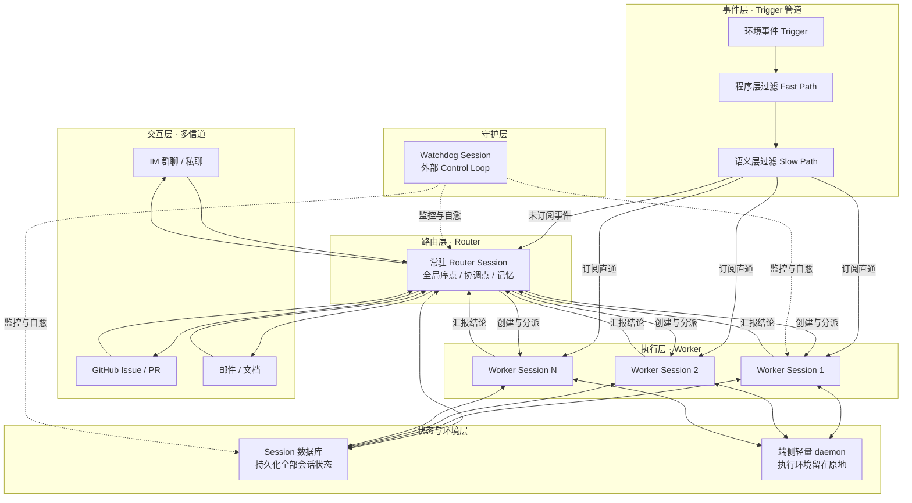

# 研究：Super-agent 设计框架与落地改造 v1

> 来源：《DeepSeek Super-agent 设计探索》
> DeepSeek Harness 团队公众号原文，2026-10-31 发布。
> 原文存档：`docs/参考-DeepSeek-SuperAgent-原文.md`
> 日期：2026-11-01
> 版本：v1
> 定性：参考架构研究（只研究不改码；不推翻已拍板决策）
> 标注约定：原文事实直接陈述。
> 工程判断标「【判断】」。
> 原文之外的补充标「【补充·非原文】」。

---

## 一、Super-agent 整体设计框架

### 1.1 分层框架图

结论：原文五模块可整理为六层。
事件自下而上进入，交互在 Router 汇聚，执行在 Worker 隔离。

层级一句话说明：

- 交互层：接入用户日常工作界面，按信道定制输出。
- 事件层：收环境事件，先过滤再路由。
- 路由层：全局唯一对人出口，只分派不执行。
- 执行层：隔离上下文，并发干具体活。
- 状态与环境层：状态入库，环境留原地。
- 守护层：主系统之外的监控与自愈回路。

### 1.2 核心模块清单

#### Router 层（双层架构之上层）

常驻的全局路由层，充当全局序点、协调点与记忆。
只做人类交互与任务分派，不执行具体任务。
可不配 Bash 工具，轻量模型往往够用。

#### Worker 层（双层架构之下层）

上下文彼此隔离的执行会话，挂完整工具。
不直接对人输出，只向 Router 汇报状态与结论。
内部可再含 Subagent 或 Agent Team，对上层透明。

#### Trigger 事件管道（事件驱动）

群聊消息、邮件、CI 结果等半结构化事件统称 Trigger。
驱动输入从「人逐条打字」变为「环境持续产事件」。
这是主动性（主动）的来源。

#### 两级过滤（Fast Path / Slow Path）

程序层先做确定性准入，滤掉大部分噪音。
语义层用 LLM 判定候选事件是否值得行动。
语义层同时是自然语言策略扩展点。

#### 订阅与直通（事件路由）

同源连续事件构成 Thread，如同一 PR、同一话题。
Router 创建 Worker 后，Worker 直接订阅该 Thread。
后续事件程序直通 Worker，不再经 Router 转发。

#### 上下文组织（Inline & Spill + 链式召回）

上下文窗口当 Cache 管理。
常用信息 Inline 内联，低频信息 Spill 到窗外留引用。
对象带唯一 ID 构成引用图，支持多跳链式召回。

#### 异步 ReAct Loop（全双工）

耗时工具改为 start() 与 stop() 异步调用。
start() 立即返回 Started，不阻塞对话循环。
完成结果作为新事件回投会话，可随时 stop()。

#### 多信道交互

输出密度匹配信道带宽与使用习惯。
IM 信道轻量低打扰，验证过的硬规定是不超 100 词。
GitHub 与邮件信道给结构化高密度交付。

#### 计算、状态与环境分离

计算（Agent Loop）做成无状态，放云端弹性容器。
状态（会话）持久化入数据库。
执行环境留原地，端侧只放轻量 daemon。

#### Watchdog（外部控制回路）

主系统之外的独立 Control Loop，定时消息驱动。
既监控基础设施故障，也监控任务实质进展。
本身是完整 Agent 会话，可自然语言问诊与在线修正。

### 1.3 四个基础特征与架构的对应

- 连续 ← Router 全局记忆 + 链式召回 + 多信道统一出口。
- 高效 ← Worker 并发隔离 + 异步 Loop + Router 批处理。
- 主动 ← Trigger 事件驱动 + 两级过滤 + 投机执行。
- 持久 ← 存算分离 + 端侧 daemon + Watchdog 自愈。

原文结论：单个 ReAct Loop 撑不起这四个特征。
四个特征由五个模块共同支撑，缺一不可。

---

## 二、框架细节展开

### 2.1 模块协作关系

结论：控制权集中在 Router，执行权下放 Worker。
监督权独立给 Watchdog，三者互不越界。

调用与监听关系：

- 事件先进两级过滤，全程异步。
- 未订阅事件交 Router，Router 决定新建或改派 Worker。
- 已订阅事件由程序直通 Worker，不经 Router。
- Worker 不与人直接通信，只向 Router 汇报。
- Router 统一回复用户，并同步全局记忆。
- 同层 Worker 通常不直接通信。
- 冲突靠共享 Thread 的事件广播自行发现与解决。
- 少数跨任务协同由 Router 中转。

同步与异步：

- 人类交互与事件投递都是异步。
- 工具执行异步，前台循环不等待。
- Router 单轮推理内部是同步的，靠批处理摊薄。

跨会话衔接：

- 所有会话状态落 Session 数据库。
- 对象 ID 构成引用图，旧任务可链式召回。
- 用户跨信道提起旧任务时，Router 沿引用找回上下文。

Watchdog 与主系统：

- Watchdog 在主系统之外，独立定时驱动。
- 监控 Router 与 Worker 的存活与进展。
- 发现异常介入修复，偶发故障持续复查。

### 2.2 数据流向

结论：主链路是「事件进、过滤、路由、注入、执行、回投、统一出口」。

主链路：

1. 环境产生 Trigger。
2. 程序层过滤，滤掉无关事件。
3. 语义层过滤，留下需行动的候选。
4. 已订阅的直通 Worker，未订阅的交 Router。
5. Router 分派任务，Worker 在隔离上下文执行。
6. 执行结果作为新事件回投会话。
7. Router 汇总结论，统一回复用户。

关键数据结构：

- Trigger：一条半结构化环境事件。
- Thread：同一来源下连续事件构成的事件流。
- Worker Session：一次任务级的隔离执行上下文。
- 三者都有唯一 ID，注入时内联关联对象 ID。

上下文载体组织：

- 从最少信息开始，只给 ID 与内容摘要。
- 按局部性逐步 Inline 关联信息。
- 时空相邻内容优先内联，如前后相邻消息。
- 超长内容设长度上限，超出部分 Spill。
- Spill 保留续读入口，模型按需取全文。

链式召回路径示例：

- 从当前消息读所在 Thread。
- 从 Thread 内联 ID 追到 Worker Session。
- 再追到该 Worker 关联的另一个评审 Thread。

### 2.3 控制流程

结论：决策轻、执行重、监督独立，三者解耦。

决策循环：

- Router 每步是长输入、短输出。
- 只做交互判断与任务分派。
- 不介入单任务内部拆解。

任务调度：

- 新任务由 Router 冷启动 Worker。
- 后续事件走订阅直通，Router 不再过手。
- Worker 超出范围可退订或交回重派。

批处理机制：

- Router 推理期间到达的事件自动积压。
- 下一轮把积压事件合并注入，一次处理。
- Prefill 并行计算，单次耗时增长慢于批量。
- 上限取决于上下文长度与单轮处理条数。

提前行动（投机执行）：

- 环境信号出现即后台尝试。
- 有价值就交付，无价值就丢弃。
- 例：会议邀约先备草稿，群内问题先静默复现修复。

中断与恢复：

- 模型可调 stop() 终止过长的后台命令。
- 新输入在当前推理步结束后即被处理。
- 设备重新上线后，云端自动触发滞留任务。
- 严重异常由 Watchdog 介入修复。

### 2.4 关键技术机制

#### 事件过滤（两级）

- 思想来源：计算机系统的 Fast Path / Slow Path。
- 程序层：按来源、群组、白名单做确定性准入。
- 三档处置：仅响应明确请求、作为候选、直接忽略。
- 语义层：LLM 按提示词策略判是否行动。
- 收益：大模型只处理少量候选，成本可控。

#### 事件路由（订阅与直通）

- Thread 内后续事件由程序直通已订阅 Worker。
- Router 只判未订阅的新事件。
- 订阅是多对多：一 Worker 可订多 Thread。
- 同一 Thread 可被多 Worker 订阅。
- 广播给所有订阅者，便于自行发现冲突。
- 实验证明直通不提速，但省 37% 读缓存 token。

#### 上下文组织（Inline & Spill）

- 把上下文窗口当 Cache 管理。
- Inline：近期高概率用到的信息直接内联。
- Spill：低频完整信息留窗外，窗内留引用或摘要。
- 局部性指导顺序：先紧密关联，再时空相邻。
- 超限即截断留续读入口，按需全文读取。

#### 链式召回（Chain of Recall）

- Trigger、Thread、Session 都有唯一 ID。
- 注入时内联下一跳关联对象的摘要与 ID。
- 底层构成引用图，支持逐跳展开。
- 缓解 Router 长程丢失历史的问题。

#### 提前行动（投机执行）

- 思想来源：CPU 的投机执行。
- 后台消耗额外算力，换人类等待与介入成本下降。
- 个人助手例：邀约邮件先核日程、备草稿。
- 研发例：群内反馈先静默复现修复，确认才交付。

#### 全双工交互（异步 ReAct Loop）

- 经典 ReAct 同步 run() 会阻塞循环。
- 改造为异步 start() 与 stop()。
- start() 立即返回 Started 通知。
- 执行完成，结果作为新事件回投。
- 前台对话与后台任务完全解耦。

#### 多信道交互

- 双层架构已隔离 Worker 内部推理噪音。
- Router 统一出口，避免多会话抢答。
- IM 信道：只问直接问题、给短结论。
- 验证过的硬规定：单次回复不超 100 词。
- GitHub 与邮件：完整背景、改动说明、验证结果。

#### 计算与状态分离

- Agent Loop 的计算做成无状态。
- 持久状态全部入数据库。
- 无状态容器可水平扩展、重启、替换。
- 连续性由持久化存储保障。

#### 计算与执行环境分离

- 云端只跑 Agent Loop，不复制环境。
- 端侧放轻量 daemon，只执行命令、返回结果。
- daemon 不保存会话状态。
- 支持 BYOM，把个人开发机接入云端。
- 支持间歇在线设备，上线后补跑任务。
- 同一任务可切换执行设备。

#### Watchdog（外部控制回路）

- 主系统之外独立运行，定时消息驱动。
- 仅探活不够，还要判任务实质进展。
- 由模型判断 Worker 是否无效循环、是否偏航。
- 修复动作可在线改提示词、调触发规则。
- 外部偶发故障持续复查直至恢复。

#### Router 批处理

- 压测：Trigger 从每分钟 1 条升至 40 条。
- 平均批量从 1.0 升至 2.8。
- 单次请求耗时仅从 2.5 秒增至 3.9 秒。
- 单个决定分摊时间从 6.4 秒降到 1.6 秒。
- 结论：拥堵反而摊薄单决定成本。

#### 消融实验结论

- 场景：约 300 条消息含约 20 条工作请求，重复 5 次。
- Super-agent：p50 12.4 分钟，p95 15.7 分钟。
- 单 Session + Subagent（中性提示）：20.4 / 29.5 分钟。
- 单 Session + Subagent（优先委派）：13.8 / 29.0 分钟。
- 读缓存 token：Super-agent 2323 万。
- 去直通后 3177 万，Router 决定数增加约 30%。
- 结论一：双层架构比提示词约束更稳。
- 结论二：直通省 token，不提速。
- 原文自述：合成负载与简化环境，结果仅作初步参考。

---

## 三、设计该类框架的重点考虑问题

### 3.1 边界情况

结论：边界风险集中在事件洪峰、上下文超限与任务漂移。

问题点：

- 事件洪峰导致排队拥堵。
- 长内容挤占上下文窗口。
- 新事件超出当前任务范围。
- 设备间歇在线，任务滞留。
- 人类中途介入、接管或改方向。

设计对策（原文已给出）：

- 批处理合并积压事件。
- 超限内容 Spill 截断，留续读入口。
- Worker 可退订或交回 Router 重派。
- 设备重连后自动触发滞留任务。

设计对策（【判断】需自行设计）：

- 事件幂等键与去重。
- 任务范围变更的显式改派入口。
- 事件洪峰限流与降级阈值。

原文开放问题 8.2 的融入：

- 脱离 Session 后的任务呈现形式无定论。
- 中途介入与实时协同的产品形态待探索。

### 3.2 异常处理

结论：Agent 异常不止崩溃，更多是无效循环与偏航。

问题点：

- 工具执行报错或超时。
- 模型陷入无效循环。
- 模型偏离整体目标。
- 状态恢复失败。

设计对策（原文已给出）：

- stop() 主动终止过长命令。
- Watchdog 由模型判断进展与偏航。
- 接口报错、恢复失败由 Watchdog 兜底。

设计对策（【判断】需自行设计）：

- 工具调用超时与重试上限。
- 失败原因落库，可见可重试。
- 区分瞬时故障与永久失败。

### 3.3 性能与扩展性

结论：单 Router 够用到小团队规模，长程记忆才是真瓶颈。

问题点：

- Router 是全局单点，可能成吞吐瓶颈。
- 扩大后切分时机与粒度难定。
- 分片牺牲全局记忆连续性。
- Worker 间协作拓扑无定论。
- 跨月长程记忆制约可扩展性。

设计对策（原文已给出）：

- 批处理降低单决定推理时间。
- 订阅直通为 Router 省约 37% token。
- 规模不够时先用单 Router，勿过早切分。
- 需要时多层过滤或水平切分。

设计对策（【判断】需自行设计）：

- 本项目两人规模，暂不做 Router 分片。
- 扩容前先压测真实事件速率。

【补充·非原文】：

- 模型与系统协同设计属研究方向。
- 工程侧暂不涉及专项训练。

原文开放问题 8.1 的融入：

- 层内结构、切分粒度均无定论。
- 长程记忆是跨月运行的主要瓶颈。

### 3.4 状态管理

结论：状态必须持久化，计算保持无状态，边界要显式。

问题点：

- 状态绑定单机则无法持久在线。
- 全局记忆与分片记忆的权衡。
- 长程记忆跨月失效。
- 多实例时上下文共享与隔离边界。

设计对策（原文已给出）：

- Session 状态全部入数据库。
- 链式召回按需展开历史。
- 共享范围共用实例，隔离范围各自独立。

设计对策（【判断】需自行设计）：

- 任务状态机显式化，各态可恢复。
- 用户级行隔离作为隔离边界。
- 状态迁移写清语义，避免隐式转换。

原文开放问题 8.3 的融入：

- 组织规模扩大即在划分上下文边界。
- 边界划分方案需按场景定制。

### 3.5 安全与权限

结论：事件驱动放大攻击面，注入与凭据是两大隐患。

问题点：

- 环境事件属不可信输入。
- 提示词注入可劫持 Agent。
- 端侧私有代码与凭据暴露面大。
- 凭据进上下文即有泄露风险。
- 多实例协作的权限边界。

设计对策（原文已给出）：

- 原文只提出问题，无完整方案。
- 方向性提法：不接触凭据本身即可用凭据。
- 小而可信的范围是当前可行前提。

设计对策（【判断】需自行设计）：

- 外部内容进提示词前消毒与隔离包装。
- 明确「数据不等于指令」的提示词边界。
- 密钥集中托管、掩码展示、最小权限。
- 管理面动作全量审计。

原文开放问题 8.4 的融入：

- 云端被攻破会波及全部端侧设备。
- 跨设备连接本身引入显著隐患。

### 3.6 可观测性

结论：原文着墨最少，仅 Watchdog 诊断与实验数据可循。

问题点：

- 长期运行需看见任务进展。
- 故障要可问诊、可追溯。
- Token 成本需可核算。

设计对策（原文已给出）：

- Watchdog 可用自然语言问诊。
- 可在线修正主系统行为。
- 实验用完成时间与 token 量化效果。

设计对策（【判断】需自行设计）：

- 任务状态与失败原因全程落库。
- 调用日志按应用与模型归集。

【补充·非原文】：

- 日志、链路追踪、成本报表属业界通行做法。
- 两人自用规模，选轻量方案即可。

### 3.7 失败恢复策略

结论：主系统自愈不够，必须有外部控制回路。

问题点：

- 进程崩溃与逻辑失效都要恢复。
- 外部偶发故障需反复复查。
- 恢复动作本身不能引入新错。

设计对策（原文已给出）：

- Watchdog 独立于主系统之外。
- 偶发故障持续复查直至恢复。
- 状态恢复失败由 Watchdog 处理。
- 存算分离使计算容器可随意重启替换。

设计对策（【判断】需自行设计）：

- 恢复动作幂等，可重复执行。
- 定期备份与明确回退路径。
- 恢复记录留痕，便于事后复盘。

---

## 四、流光咖啡馆落地改造点清单

### 4.0 项目现状速写

流光咖啡馆是两人自用的 AI 应用面板，测试 291 用例全绿。
后端 FastAPI + PostgreSQL + docker-compose + Caddy，纯 IP 直连。
模型网关已有指派、备用链、熔断与计费统计。
论文域已有订阅抓取、解析、批注与翻译，Hatchet 流水线已落地。
当前没有常驻 Agent、没有外部事件源、没有多信道。

### 4.1 机制评估总览

结论：七项部分采纳，一项已达成，四项不采纳或暂缓。

- 事件驱动任务流 → 部分采纳（R1）
- 订阅与直通 → 部分采纳，并入 R1
- Watchdog → 部分采纳（R2）
- 安全注入防线 → 部分采纳（R3）
- 计算与状态分离 → 已基本达成，补规范（R4）
- 两级事件过滤 → 部分采纳（R5）
- 投机执行 → 部分采纳（R6）
- 上下文组织 Inline & Spill → 部分采纳（R7）
- 链式召回 → 已有对应物（批注互链反查）
- 其余见 4.9 不采纳与暂缓清单

### 4.2 改造点 R1：任务事件表与链式编排

评估：部分采纳（事件驱动 + 订阅直通思想）。

改造内容：

- 现在：解析、翻译、清理由 cron、按钮或函数直调触发。
- 要改成：新增任务事件表 `task_events`。
- 关键状态变化一律写事件。
- Hatchet 按事件链式衔接任务。
- 链路示例：解析完成 → 触发翻译 → 刷新 digest。
- 函数直调改为投事件，由流水线消费。

影响范围：

- 新表一张，走 Alembic 新迁移。
- 涉及 `pipeline.py`、`paper_parse.py`、`paper_translate.py`、`papers_crawl.py`。
- Hatchet 控制台可见完整任务链。
- 用户可见：解析完自动翻译更可靠，单步失败可单独重试。
- 同步文档：论文域增量文档、架构设计增量。

优先级与顺序理由：

- P0。
- 论文域正在迭代，收益最直接。
- 事件表是 R2 的地基。
- 不动已拍板的 Hatchet 形态（D7、D8）。

### 4.3 改造点 R2：Watchdog 守护清扫

评估：部分采纳（Watchdog 思想裁剪为库内扫描版）。

改造内容：

- 现在：任务卡死只靠人工看状态列，无自愈。
- 要改成：新增守护 workflow，Hatchet 定时跑。
- 扫描超时的运行中任务。
- 先自动重试一次，再失败标 failed 并写原因。
- 管理页展示最近守护动作。
- 【判断】不做 LLM 会话式 Watchdog，规模不需要。

影响范围：

- `pipeline.py` 新增 workflow。
- 涉及 `parse_status`、`translate_status` 等状态列。
- 用户可见：卡死任务自动恢复或给出明确失败原因。
- 同步文档：架构设计增量。

优先级与顺序理由：

- P0。
- 多条任务线已在跑，卡死风险现实。
- 依赖 R1 的事件表更省，故排 R1 之后。

### 4.4 改造点 R3：事件注入防线

评估：部分采纳（源自原文 8.4 安全议题）。

改造内容：

- 现在：论文摘要等外部文本直接拼进提示词。
- 要改成：外部文本进提示词前统一消毒。
- 加隔离包装，声明「数据不等于指令」。
- 渲染出口沿用 `render_service`（nh3）。

影响范围：

- 涉及 `paper_translate.py`、`papers_crawl.py` 打标、`model_caller` 注入点。
- 无表结构变化。
- 用户可见：无感，安全性提升。
- 同步文档：架构设计增量。

优先级与顺序理由：

- P1。
- R1 放量前先立防线，成本最低。
- 可与 R1 并行，但建议先行小步交付。

### 4.5 改造点 R4：任务状态机与可恢复规范

评估：部分采纳（计算与状态分离的收尾动作）。

改造内容：

- 现在：各任务状态列语义分散，恢复各自实现。
- 要改成：统一状态机约定。
- 基本态：`pending`、`running`、`done`、`failed`。
- 补超时语义与重入语义。
- 每次状态转换可幂等重放。
- 写成共享知识文档。

影响范围：

- 涉及 `paper_parse.py`、`paper_translate.py`、`papers_crawl.py` 状态写点。
- 后续新任务照此实现，不再各写一套。
- 同步文档：架构设计增量。

优先级与顺序理由：

- P1。
- 在 R1、R2 落地后固化规范，避免返工。
- 规范先行成本低，返工成本高。

### 4.6 改造点 R5：digest 两级过滤精化

评估：部分采纳（Fast Path / Slow Path）。

改造内容：

- 现在：关键词命中与打分混在抓取逻辑内。
- 要改成：确定性关键词命中为 Fast Path。
- 先筛掉大部分，只对候选做 LLM 复核。
- 口径更清晰，成本更低。

影响范围：

- 涉及 `papers_crawl.py` 打标与 digest 聚合。
- LLM 调用减少，计费统计随之下降。
- 用户可见：digest 更准、检索更快。
- 同步文档：论文域增量文档。

优先级与顺序理由：

- P2。
- 现口径可用，此为优化。
- 等 R1 链式任务稳定后再动。

### 4.7 改造点 R6：高相关论文投机预解析

评估：部分采纳（投机执行）。

改造内容：

- 现在：用户点「收藏并解析」才下载解析。
- 要改成：高相关论文自动预下载、预解析。
- 失败静默，不打扰用户。
- 用户打开时直接可读。
- 范围收窄：仅高相关、仅可获全文的条目。

影响范围：

- 涉及 `paper_parse.py`、`pipeline.py` 新增预解析任务。
- COS 存储用量上升。
- MinerU 调用与带宽成本上升。
- 用户可见：高相关论文开箱即读。
- 同步文档：论文域增量文档。

优先级与顺序理由：

- P2。
- 体验收益好，但有真实成本。
- 需用户拍板成本上限后再做。

### 4.8 改造点 R7：长对话上下文压缩

评估：部分采纳（Inline & Spill）。

改造内容：

- 现在：对话按保留轮数截断，旧消息直接丢。
- 要改成：超阈值时旧消息压缩成摘要。
- 近期消息保持原文（Inline）。
- 旧消息摘要留存（Spill），随会话续写。

影响范围：

- 涉及 `chat_service.py` 上下文组装、`chat_messages` 读取逻辑。
- 用户可见：长对话不再突然失忆。
- 成本：摘要生成多一次模型调用。
- 同步文档：架构设计增量、PRD（对话行为变化）。

优先级与顺序理由：

- P2。
- 改变对话记忆行为，需用户拍板。
- 与「系统提示词为内置常量」决策不冲突。

### 4.9 不采纳与暂缓清单

- Router/Worker 双层：不采纳。两人规模、无常驻 Agent，请求响应够用。
- Router 批处理：不采纳。事件量极小，批处理无收益。
- 多信道交互：不采纳。与 P1「页内 digest、不做外部推送」拍板一致。
- 计算与执行环境分离（BYOM）：不采纳。单机自部署，无跨设备需求。
- LLM 会话式 Watchdog：不采纳。由 R2 的库内扫描版替代。
- 全双工异步工具（start/stop）：暂缓。chat 现为一次性 SSE。
  等 Skill 或 MCP 长任务出现再议。此项**需用户拍板**是否列入路线。
- Worker 直接通信与协同拓扑：暂缓。原文亦称无定论，本项目无此需求。

### 4.10 升级顺序总览

1 | R1 任务事件表与链式编排 | 论文域进行中，收益最直接
2 | R2 Watchdog 守护清扫 | 紧随事件表，卡死风险现实
3 | R3 事件注入防线 | 事件放量前先立安全防线
4 | R4 状态机与可恢复规范 | 机制落地后固化规范
5 | R5 digest 两级过滤精化 | 现口径能用，属优化
6 | R6 投机预解析 | 等成本拍板后再做
7 | R7 长对话上下文压缩 | 等对话行为拍板后再做

### 4.11 后续实施衔接

- R1、R2、R4 并入论文域增量文档，出单步实施指令。
- R3 独立小步，可先行交付。
- R5 随 digest 优化需求走。
- R6、R7 拍板后再出增量设计。
- 节奏沿用既有分步制：本会话出计划与单步指令，开发会话执行一步，反馈后给下一步。

---

## 附：需用户拍板事项汇总

1. R6 投机预解析：成本上限与触发范围。
2. R7 长对话压缩：是否改变对话记忆行为。
3. chat 全双工异步工具：是否列入对话演进路线。
